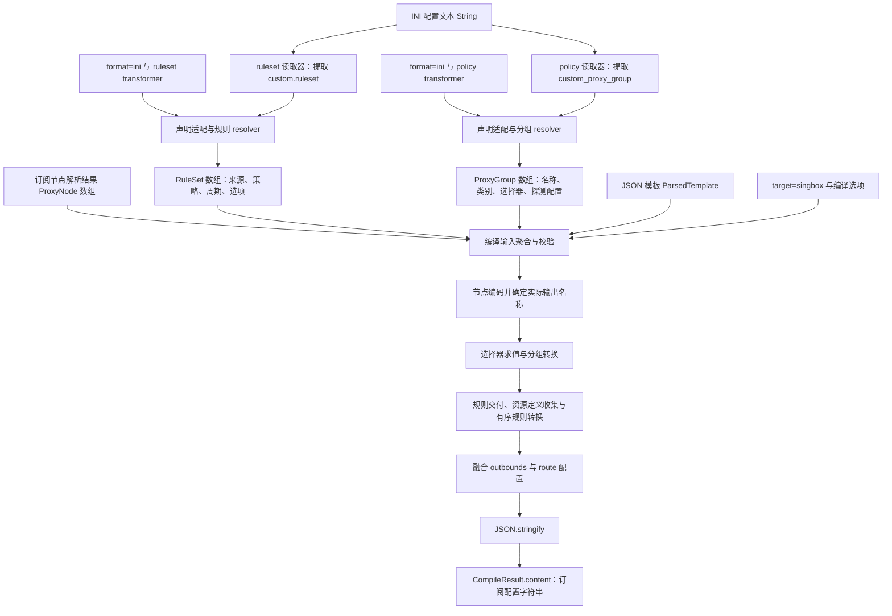
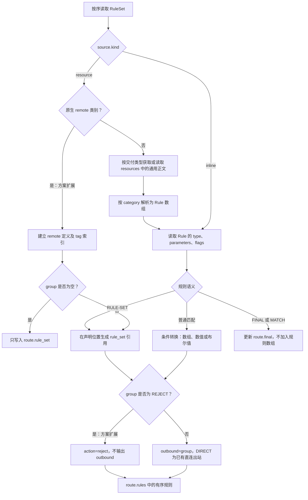
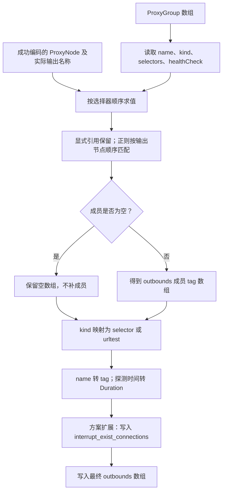

# sing-box 数据类型与字段转换

## 范围与依据

本文说明 INI 配置经过 ruleset/policy 解析，得到中间数据，再编译为 sing-box 订阅配置的字段转换过程。外部语法和支持范围以[核心配置简表](sing-box%20核心配置简表.md)为准，新增字段与兼容行为以[兼容调整方案](sing-box%20规则与策略兼容调整方案.md)为准；本文不另行定义语法。

以下“现有”表示源码中已有的契约或处理，“方案扩展”表示上述方案规定、尚需同步实现的能力。原生 remote、selector 别名、PRIVATE、多 tag RULE-SET、REJECT 目标及新增可选字段均按方案扩展描述，不宣称现有运行时代码已全部支持。

## 总体数据流



INI 字段名不是最终 JSON 字段名：policy 的输出类型是 ProxyGroup，不是一个名为 policy 的目标对象；ruleset 的输出类型是 RuleSet，不是原生 route.rule_set 对象。代理节点来自独立的订阅节点链路，不能只凭 INI 规则和分组生成协议节点。

## 阶段类型与职责

| 阶段          | 输入                                                 | 输出数据                       | 字段处理边界                                                         |
| ------------- | ---------------------------------------------------- | ------------------------------ | -------------------------------------------------------------------- |
| 文本读取      | String、format=ini                                   | 带 position 的规则或分组条目   | 仅提取 custom 节重复项，保留各自顺序和来源位置                       |
| 规则声明适配  | 单条 ruleset 文本                                    | RulesetDeclaration             | 分离 group、source、category、interval、options；不请求资源          |
| 规则 resolver | 规则声明、transformer                                | RuleSet                        | 内联正文变为 Rule；资源保留 address；原生 remote 按方案扩展 options  |
| 分组声明适配  | 单条 custom_proxy_group                              | GroupDeclaration               | 分离 name、kind、成员及探测尾部；不筛选节点                          |
| 分组 resolver | 分组声明、transformer                                | ProxyGroup                     | 将成员变为 selectors，将时间与开关归一化为类型化字段                 |
| 编译输入聚合  | ProxyNode[]、ProxyGroup[]、RuleSet[]、ParsedTemplate | CompileParams / CompileContext | 聚合输入、校验目标及模板；资源正文由 resources 关联                  |
| 目标转换      | 编译上下文                                           | 目标 JSON 对象                 | 编码节点、求值选择器、生成资源定义及路由、融合模板                   |
| 序列化        | 目标对象                                             | CompileResult                  | content 为字符串，contentType 为 JSON 媒体类型；diagnostics 单独返回 |

现有类型定义见[规则契约](../../../lib/subscription/types/ruleset.ts)、[分组契约](../../../lib/subscription/types/policy.ts)、[编译契约](../../../lib/subscription/types/compile.ts)。本文只展开转换所需字段，不维护这些类型的完整副本。

当前驱动内部使用 TargetObject，即键为字符串、值为 TemplateValue 的对象；TemplateValue 递归表示 JSON 的 null、布尔、数值、字符串、数组和对象。这里的目标对象不包含解析期的回调或选择器执行状态；最终序列化后不再保持对象类型，而是 String 配置内容。类型定义见[编译内部契约](../../../lib/subscription/compile/types.ts)与[模板值类型](../../../lib/subscription/types/template.ts)。

解析入口返回的 items 是有效中间数据，diagnostics 保存声明问题及位置，不写进目标配置。编译节点按输入数组和连线顺序聚合，不按分组名或规则目标重新排序；最多接受一份模板。具体输入聚合见[编译节点输入](../../../lib/workflow/flows/configuration/compile-node/runtime/input.ts)。

## INI → RuleSet

### 字段转换

| INI 中的内容                  | 中间数据                                                    | 解释                                                                   |
| ----------------------------- | ----------------------------------------------------------- | ---------------------------------------------------------------------- |
| 第一列策略                    | group                                                       | 保留策略名大小写；方案中仅原生 remote 允许空字符串，表示只定义         |
| 规则项位置                    | id 与诊断 position                                          | id 标识声明，不作为资源 tag；position 用于定位输入问题                 |
| 来源前缀                      | category                                                    | 通用类别沿用现有 resolver；方案中的原生 remote 归入 singbox            |
| `[]DOMAIN-SUFFIX,example.com` | source.kind=inline，source.rule                             | Rule 中 type 为 DOMAIN-SUFFIX，parameters 为单元素数组，flags 独立保存 |
| HTTP(S) 资源来源              | source.kind=resource，source.address                        | 去掉声明前缀后保存地址，不在解析阶段读取正文                           |
| 更新周期                      | 原生 remote 为 interval?:number，其他类别为 interval:number | 单位为秒；原生 remote 的省略和空占位不生成该字段，其他类别遵循已有约定 |
| remote 显式 tag               | options.tag                                                 | 方案扩展；用于后续定义和引用，不复用 group 或 id                       |
| remote 显式格式前缀           | options.format                                              | 方案扩展；显式 source/binary 才保存，自动推断写法保持未设置            |
| remote 下载出站               | options.downloadDetour                                      | 方案扩展；原样保留出站名，未设置不自动补值                             |

通用 flags 与 options.noResolve、options.stashFormat 继续使用既有职责，不挪作 remote 配置。原生 remote 不经过通用 Rule 文本解析，也不把 SRS 解码为字符串。语法分词和类别约束见[规则解析器](resolvers.md)，新增位置字段的限制见兼容方案。

### 通用规则的中间形态

```ini
ruleset=手动选择,[]DOMAIN-SUFFIX,example.com
ruleset=规则之外,[]FINAL
```

对应的转换关键字段如下，id 为说明用声明标识：

```json
[
  {
    "id": "ruleset:0",
    "group": "手动选择",
    "category": "surge",
    "source": { "kind": "inline", "rule": { "type": "DOMAIN-SUFFIX", "parameters": ["example.com"], "flags": [] } },
    "interval": 86400,
    "options": {}
  },
  {
    "id": "ruleset:1",
    "group": "规则之外",
    "category": "surge",
    "source": { "kind": "inline", "rule": { "type": "FINAL", "parameters": [], "flags": [] } },
    "interval": 86400,
    "options": {}
  }
]
```

这里采用方案规定的 singbox transformer 通用内联分派；当前使用 surge transformer 也可产生同形态数据。FINAL 的目标保存在 group，正文不需要重复携带目标参数。

### 原生 remote 的中间形态（方案扩展）

```ini
ruleset=,singbox-binary:https://example.com/proxy.srs,86400,proxy,手动选择
```

```json
{
  "id": "ruleset:2",
  "group": "",
  "category": "singbox",
  "source": { "kind": "resource", "address": "https://example.com/proxy.srs" },
  "interval": 86400,
  "options": { "tag": "proxy", "format": "binary", "downloadDetour": "手动选择" }
}
```

category、options 的新增取值和空 group 规则须按兼容方案扩展运行时 schema；不能直接将上例传入现有严格字段校验并宣称可用。若首列改为手动选择，中间形态只改变 group，编译阶段才额外生成该位置的路由引用。

## RuleSet → sing-box 规则配置



### 原生 remote 字段映射（方案扩展）

| RuleSet 字段                    | 目标字段                                   | 转换                                                             |
| ------------------------------- | ------------------------------------------ | ---------------------------------------------------------------- |
| category=singbox、resource 分支 | route.rule_set[].type                      | 固定 remote                                                      |
| source.address                  | route.rule_set[].url                       | 保留 URL，不携带来源前缀                                         |
| options.tag                     | route.rule_set[].tag                       | 显式值原样使用；缺省由编译阶段按方案命名与避让冲突               |
| options.format                  | route.rule_set[].format                    | 显式值直接写入；自动推断写法不输出 format                        |
| interval                        | route.rule_set[].update_interval           | 仅显式设置时将秒数转 Duration，例如 86400 → 86400s；未设置时省略 |
| options.downloadDetour          | route.rule_set[].download_detour           | 方案要求显式映射；缺省不输出，也不改写为 http_client             |
| 非空 group                      | route.rules[].rule_set、outbound 或 reject | 在声明位置引用该资源 tag；空 group 不创建路由项                  |

定义索引先于路由引用生成，允许先引用、后定义。定义按 tag 和规范化配置检查复用及冲突；同 tag 同定义复用，不同定义报错。下载字段、tag 命名及版本兼容约束由[兼容方案](sing-box%20规则与策略兼容调整方案.md)统一规定，不通过本转换说明另行改变。

### 通用 Rule 字段映射

| 中间规则                            | sing-box 输出                     | 转换要点                                                                                                    |
| ----------------------------------- | --------------------------------- | ----------------------------------------------------------------------------------------------------------- |
| DOMAIN / DOMAIN-SUFFIX 等字符串条件 | domain / domain_suffix 等数组字段 | parameters 转条件值；目标策略来自外层 group，不取正文的原策略                                               |
| 端口、用户标识等数值条件            | 对应数值或数值数组                | 先验证范围再转换 number，不作为普通字符串透传                                                               |
| PRIVATE,true/false                  | ip_is_private 布尔值              | 方案扩展，显式 false 不能被统一转成 true                                                                    |
| RULE-SET 的 tag 参数                | rule_set 字符串或数组             | 方案扩展；多个参数作为同一条规则的引用数组，保留大小写                                                      |
| GEOIP / GEOSITE / SRC-GEOIP 条件    | 不输出规则                        | 返回不支持诊断；资源定义与引用统一遵循[兼容方案](sing-box%20规则与策略兼容调整方案.md#52-remote-定义与引用) |
| FINAL / MATCH                       | route.final                       | 外层 group 作为目标，不输出 route.rules 项                                                                  |

普通 group 生成 outbound 路由，REJECT 生成拒绝动作；PRIVATE 和显式多 tag RULE-SET 的字段映射见上表。reject 不创建同名 outbound，也不能作为分组成员、下载出站或 FINAL。

本方案中的原生 remote 引用按声明分别输出；显式 `[]RULE-SET,a,b` 直接生成一条数组引用，不逐 tag 拆分。资源定义复用不会自动合并不同声明的路由引用；具体顺序遵循核心简表和兼容方案。

## INI → ProxyGroup

| INI 段                   | 中间字段                                   | 转换                                                             |
| ------------------------ | ------------------------------------------ | ---------------------------------------------------------------- |
| 名称                     | name                                       | 保留组名                                                         |
| select                   | kind=select                                | 直接选择组                                                       |
| selector                 | kind=select                                | 方案扩展；仅作为 singbox 输入别名，不新增通用 kind               |
| 普通成员正则             | selectors 中 kind=name、pattern            | 保存正则文本，不在解析时筛选节点                                 |
| `[]名称`                 | selectors 中 kind=reference、name          | 保存明确的节点、组或 DIRECT 引用                                 |
| url-test 的探测 URL      | healthCheck.url                            | 从成员尾部取出，不作为成员选择器                                 |
| `60,,50`                 | healthCheck.interval / timeout / tolerance | interval=60、tolerance=50；timeout 保持未设置且不输出到 sing-box |
| selector 末段 true/false | interruptExistConnections                  | 方案扩展；显式 false 与未设置区分，不保存为成员正则              |

providerRefs 与其余选择器结构沿用[分组解析约定](../policy/resolvers.md)。当前编译服务拒绝非空 providerRefs，不能因为解析能够产生引用，就在示例中假设目标生成器能直接消费 provider。

```ini
custom_proxy_group=手动选择`selector`[]香港优选`[]DIRECT`true
custom_proxy_group=香港优选`url-test`(香港)`https://www.gstatic.com/generate_204`60,,50
```

对应中间数据（包含待扩展的开关字段）：

```json
[
  {
    "name": "手动选择",
    "kind": "select",
    "selectors": [
      { "kind": "reference", "name": "香港优选" },
      { "kind": "reference", "name": "DIRECT" }
    ],
    "providerRefs": [],
    "interruptExistConnections": true
  },
  {
    "name": "香港优选",
    "kind": "url-test",
    "selectors": [{ "kind": "name", "pattern": "(香港)" }],
    "providerRefs": [],
    "healthCheck": { "url": "https://www.gstatic.com/generate_204", "interval": 60, "tolerance": 50 }
  }
]
```

现有 select 写法不截取末尾名称为 true/false 的正则；selector 别名的布尔尾段处理只属于方案扩展。

## ProxyGroup → outbounds



| ProxyGroup 字段           | 目标字段                    | 转换                                                       |
| ------------------------- | --------------------------- | ---------------------------------------------------------- |
| name                      | tag                         | 原样作为分组 tag                                           |
| kind=select               | type=selector               | 使用 sing-box 的类型名                                     |
| kind=url-test             | type=urltest                | 使用原生测速组类型                                         |
| selectors                 | outbounds                   | 结合成功编码节点求值后写入 tag，不能直接输出 selector 对象 |
| healthCheck.url           | url                         | 显式设置时写入，未设置时省略                               |
| healthCheck.interval      | interval                    | 显式设置时将数值秒转 Duration，例如 60 → 1m；未设置时省略  |
| healthCheck.tolerance     | tolerance                   | 显式设置时输出毫秒数，包括 0；未设置时省略                 |
| healthCheck.timeout       | 无对应输出                  | 不误写为 interval 或其他 sing-box 字段                     |
| interruptExistConnections | interrupt_exist_connections | 方案扩展；未设置时省略，显式 false 保留                    |

分组支持范围、未设置的测速字段及空成员处理遵循[兼容方案](sing-box%20规则与策略兼容调整方案.md#4-策略模块)。成员正则匹配的是成功编码后的 ProxyNode，不是所有输入节点；不支持的协议节点不能继续参与普通正则成员展开。

## 编译与资源正文的数据交付

编译节点将规则、策略、节点和模板聚合为 CompileParams：target、nodes、groups、rulesets、template，以及需要展开时提供的 resources。format/transformer 属于解析配置，不作为每条规则或分组的输出字段；target 决定最终驱动，不从输入地址猜测。

- 内联 Rule 已在 source.rule 中，编译无需取得资源正文。
- 原生 remote 按方案交付为 remote，只写入定义，不在应用端下载 JSON/SRS。
- 通用资源按交付策略决定是否展开；expand 的正文由资源加载层按 address 提供到 `resources[address]`，再按 category 解析为 Rule[]。同一地址的正文可复用，但不同声明的 group 和位置仍独立。

资源交付参考[交付分类](sing-box%20规则与策略兼容调整方案.md#51-交付分类)与[工作流资源加载](../../../lib/workflow/flows/configuration/compile-node/runtime/resources.ts)。category=singbox 的新分支须先接入 ruleDelivery，再进入资源加载判断，不能让它落入现有默认 expand 分支。

## 贯穿示例：中间数据到订阅 JSON

以下是方案目标示例，不是对现有运行时已经完成扩展的声明。格式和新增字段的验证要求仍以兼容方案为准。

### INI 输入

```ini
[custom]
custom_proxy_group=手动选择`selector`[]香港优选`[]DIRECT`true
custom_proxy_group=香港优选`url-test`(香港)`https://www.gstatic.com/generate_204`60,,50

ruleset=,singbox-binary:https://example.com/proxy-a.srs,86400,proxy-a,手动选择
ruleset=,singbox-binary:https://example.com/proxy-b.srs,86400,proxy-b,手动选择
ruleset=,singbox-source:https://example.com/ads.json,86400,ads,手动选择
ruleset=手动选择,[]DOMAIN-SUFFIX,example.com
ruleset=DIRECT,[]PRIVATE,true
ruleset=手动选择,[]RULE-SET,proxy-a,proxy-b
ruleset=REJECT,[]RULE-SET,ads
ruleset=手动选择,[]FINAL
```

三条 remote 的 group 均为空，因此只产生资源定义；后续通用内联声明分别提供匹配、引用、拒绝和默认出口。两个代理规则集在一条 RULE-SET 中声明，因此生成一个数组引用。

假设独立的节点解析链路提供一个名称为香港节点1的可用 Shadowsocks 节点，ProxyNode 的必要输入为：

```json
{
  "protocol": "ss",
  "name": "香港节点1",
  "server": "hk.example.com",
  "port": 8388,
  "encryption": "aes-128-gcm",
  "password": "example"
}
```

编译模板为 JSON，提供需要保留的 DNS、入站和其他设置；target=singbox。规则生成开关开启，模板普通规则在此例设为空。成员求值后香港优选包含香港节点1，手动选择引用香港优选与 DIRECT。

### 生成字段

下面仅展示发生转换的 outbounds 和 route 字段；模板其他成员不在片段内展开。示例保留生成的 DIRECT，不自动生成 GLOBAL 分组或 Clash 模式规则。

```json
{
  "outbounds": [
    { "type": "direct", "tag": "DIRECT" },
    {
      "type": "shadowsocks",
      "tag": "香港节点1",
      "server": "hk.example.com",
      "server_port": 8388,
      "method": "aes-128-gcm",
      "password": "example"
    },
    { "type": "selector", "tag": "手动选择", "outbounds": ["香港优选", "DIRECT"], "interrupt_exist_connections": true },
    {
      "type": "urltest",
      "tag": "香港优选",
      "outbounds": ["香港节点1"],
      "url": "https://www.gstatic.com/generate_204",
      "interval": "1m",
      "tolerance": 50
    }
  ],
  "route": {
    "rules": [
      { "domain_suffix": ["example.com"], "action": "route", "outbound": "手动选择" },
      { "ip_is_private": true, "action": "route", "outbound": "DIRECT" },
      { "rule_set": ["proxy-a", "proxy-b"], "action": "route", "outbound": "手动选择" },
      { "rule_set": "ads", "action": "reject" }
    ],
    "rule_set": [
      {
        "type": "remote",
        "tag": "proxy-a",
        "format": "binary",
        "url": "https://example.com/proxy-a.srs",
        "update_interval": "86400s",
        "download_detour": "手动选择"
      },
      {
        "type": "remote",
        "tag": "proxy-b",
        "format": "binary",
        "url": "https://example.com/proxy-b.srs",
        "update_interval": "86400s",
        "download_detour": "手动选择"
      },
      {
        "type": "remote",
        "tag": "ads",
        "format": "source",
        "url": "https://example.com/ads.json",
        "update_interval": "86400s",
        "download_detour": "手动选择"
      }
    ],
    "final": "手动选择"
  }
}
```

显式 format 来源于 singbox-binary / singbox-source，而不是资源正文内容。下载出站与流量出站分开解释；这里恰好同名，不意味着两者自动关联。测速间隔按当前 duration() 输出为 1m，与简表中的 60s 时长等价；remote 更新周期的方案示例使用 86400s。

最终对象经过 JSON.stringify 变为 CompileResult.content 字符串，contentType 为 `application/json; charset=utf-8`。资源和规则的中间类型、选择器、声明 id 及 diagnostics 都不写入该 JSON。该片段说明字段转换，不包含远程正文检查或 sing-box 启动验证。
