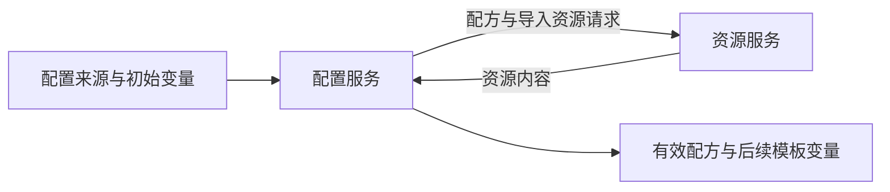

# 模板和配置

## 两层模板

`base/config/example_external_config.ini` 是转换配方，不是客户端最终配置。`[custom]` 定义策略组、规则资源、节点处理和目标基础配置路径；`*_rule_base` 指向客户端原生 YAML、INI 或 JSON 底稿。重写时必须分离配方解析器与目标底稿解析器。

`handler/external_config_async.cpp::AsyncExternalConfigState` 按“取配方→渲染配方→解析→发现缺失 import→取 import→重新解析”运行。每轮解析使用新的 ExternalConfig 和模板参数副本，避免部分解析污染结果；最终成功才交付配置。模板渲染支持异步资源获取，不能视为纯字符串替换。

`handler/settings.cpp::parseExternalConfigContent` 按内容识别 YAML custom、带 version 的 TOML，最后尝试 INI，并非仅按扩展名选择。INI 使用 custom 作为孤立行区域。

## INI 语义

重复键必须保留顺序和值，不能使用普通单值字典。custom_proxy_group、ruleset、rename、emoji、include_remarks、exclude_remarks、ruleprepend、ruleappend 都会读取多个值。ruleset 存在时优先于旧名 surge_ruleset。

布尔开关用“存在时赋值”方式读取；缺省与 false 必须区分。rename 以最后一个 @ 分隔匹配式与替换值；emoji 使用最后一个逗号分隔。绑定器也接受 script: 形式，脚本执行属于独立能力。

`!!import:` 引入片段，展开后再绑定策略组或规则。导入失败与配置语法错误是不同错误。导入受 FetchContext、API 模式、数量及字节预算限制，不得把任意本地路径当成可信资源。

`[template]` 被解析为 local_vars。由于它在配方渲染完成后才从 INI 提取，不能假定同一配方中的变量声明能够反向影响已经执行的配方渲染；后续底稿渲染应使用更新后的参数。

## 缓存和失败

settings.cpp 的外部配置解析缓存身份包含内容摘要、FetchContext、配置代次和解析器身份。包含 import/script 动态标记的内容不作为普通静态内容缓存。跨语言实现不能只以路径为缓存键。

加载状态区分 FetchFailed、RenderFailed、ParseFailed、ImportFailed、ResourceLimitExceeded、Deadline、Cancelled、Shutdown；异步入口保证完成回调只发生一次。重写建议保持此区分，并保留失败阶段。

依据：`handler/settings.cpp::loadExternalConfigFromRenderedContent`、`handler/external_config_async.cpp`、`config/binding.h`、`generator/template/templates.cpp`。

## 配方加载数据流

下图描述现有加载依赖；失败出口统一返回加载状态，图中省略调度器内部细节。

配置服务内部负责导入展开及必要的重新解析，不表示重复渲染原始配方。[template] 变量的阶段约束见上文；不能将回边实现为无约束递归加载。
