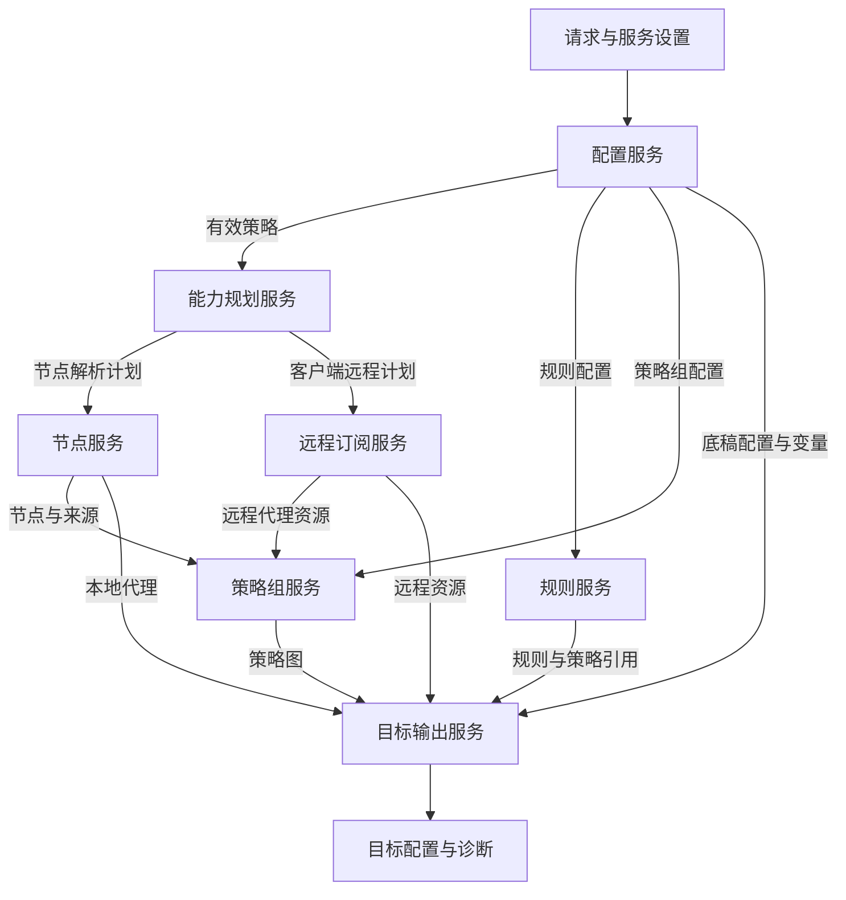

# 转换流程与配置边界

请求解析首先确定 target；auto 依据客户端身份解析为实际目标。实际目标决定节点解析器和远程订阅后端，必须在输入解析前完成。

核心流程为：请求归一化→加载外部配方→合成有效策略→选择远程后端→分类输入源→解析直接节点或生成远程资源→处理节点与策略组→加载并渲染底稿→规则转换→目标输出与引用校验。

依据为 `handler/interfaces.cpp` 中 ParsedSubRequest、EffectiveSubPolicy、kTargetDescriptors 和远程模式分派，以及 `handler/conversion_pipeline.cpp`。异步外部配置由 `external_config_async.cpp` 承接。

## 合成规则

不要实现一个对所有字段通用的深合并。底稿选择、节点开关、重复规则、模板变量和请求参数有各自读取规则。应在有效策略中记录字段来源；未设置的布尔值应保留三态。外部配置对各目标提供独立 rule_base，不能用 Clash 底稿作为所有客户端通用底稿。

nodelist 会把远程订阅模式改为服务端解析。对原生远程客户端，能力判定不通过也会进入服务端解析；该判定发生在获取和导出前，属于执行计划的一部分。

## 资源边界

配方、import、订阅、规则集和底稿虽然都可能使用网络获取，但信任上下文和缓存有效期不同。公共请求对本地资源有限制；可信本地资源有专门判断。获取成功要求响应和内容有效，空内容不能直接解释为合法空配方。

请求持有 SettingsSnapshot、取消令牌、截止时间与资源预算。导入重试会累计保留字节，不能通过反复解析绕过预算。取消和关闭必须终止后续阶段；缓存中不能混用不同上下文的解析结果。

重写建议让所有 I/O 经过 ResourceResolver，返回内容、来源身份及结构化错误；纯转换阶段消费已解析资源，避免生成器偷偷发起网络请求。

## 总体数据流

此图表达模块依赖，不要求独立资源按图中视觉位置串行获取。EffectivePolicy 是合成后的数据，不承担 I/O。

“远程资源计划”仍可包含直接节点，它们进入服务端节点链路；两条边不是互斥请求模式。最终校验是建议统一的架构边界，现实现的检查强度依目标而异，Stash 有专门的最终图校验。
