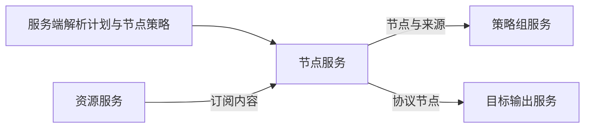

# 代理模型与协议保真

## 输入解析边界

Clash/ClashR 使用 MihomoOnly；其余目标使用 LegacyOnly。`generator/config/nodemanip.cpp` 在目标解析后选择路径。Mihomo 桥接错误采取关闭式失败，不应无声改走旧解析器。构建是否具备桥接能力也必须作为运行能力暴露。

`bridge/parser.go` 对原生 YAML 严格验证，对 URI 订阅逐节点过滤，全部无效时失败。桥接输出经 `parser/mihomo_bridge.cpp` 变为 C++ Proxy。因此“同一订阅换 target 后输入表现不同”是现有边界，重写时不能只复制输出函数。

## 领域字段分组

`parser/config/proxy.h::Proxy` 是联合协议信息的扁平结构。跨语言建议改为公共端点、协议参数、传输参数、TLS 参数及来源的组合，并以协议标签约束字段。

| 协议族 | 必须区分的语义 |
| --- | --- |
| SS / SSR | 加密方法、密码、插件及插件参数；SSR 另有 protocol、obfs 及参数，不能与传输类型混用 |
| VMess / VLESS | UUID；VMess alterId；传输与 TLS 独立，VLESS 不能当作 VMess 别名 |
| Trojan / AnyTLS | 密码认证和 TLS；AnyTLS 会话参数应归入自身协议 |
| HTTP / HTTPS / SOCKS5 | 用户名密码可选；HTTPS 的代理传输 TLS 与节点名称无关 |
| Snell | 版本、复用、用户密钥、网络、UDP 端口以及 ShadowTLS 字段分别保留 |
| WireGuard | 密钥、本地地址、多个 peer、AllowedIPs、保活、reserved；旧单 peer 投影不能覆盖完整结构 |
| Hysteria / Hysteria2 | 认证、带宽、混淆、端口跳跃和 TLS；两代认证及参数不可互换 |
| TUIC | UUID、密码、拥塞控制、ALPN 等，不复用 VMess 身份模型 |
| Naive | 并发、QUIC、UOT 使用独立字段和三态开关 |
| Mieru | 交给专门协议解析及能力判定，不能降格为普通 SOCKS5 配置 |

Hysteria2 的 ECH 字段用于符合规范的单链接回转，不会安全地投影到所有旧客户端生成器；PortsAreAdditional 区分 URI 的附加端口与原生配置完整端口范围。WireGuardPeers 和 WireGuardLocalAddresses 是完整信息，历史 Hostname 等字段仅兼容旧消费者。

## 输出能力

协议被识别、字段进入模型、目标生成器支持、远程客户端能够加载是四个独立条件。Clash 的原生节点输出集中在 `generator/config/clash_proxy.cpp`，其他客户端与单链接输出在 subexport.cpp。桥接能力元数据来自固定 Mihomo 依赖生成的 manifest，不能当作 Surge 或 sing-box 的能力表。

重写建议返回 supported / lossy / unsupported 和字段级原因；兼容原行为时另行区分“跳过节点”和“整次失败”。保留原始协议字段并不等于承诺目标可以输出这些字段。

## 节点处理数据流

节点服务封装解析与节点变换，图中不展开内部执行顺序。跨语言实现应在该模块内部保持原处理顺序，避免 rename 后正则匹配语义改变；远程订阅中的未知节点不进入此框。
