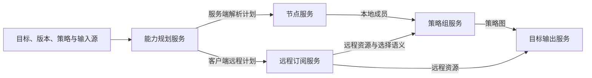

# 远程订阅与 provider 深析

## 三种不同资源

代理 provider 提供节点；规则 provider 提供匹配条件；import 提供转换器配置片段。三者刷新者、内容格式、引用位置和信任边界不同，不应共用一个 Provider 类型。

## Clash / ClashR

`interfaces.cpp` 的 ClashProxyProvider 分支将 HTTP 订阅转换为远程描述，不在服务端枚举其中节点。显式 node: 或支持的非 HTTP 协议作为直接节点解析，因此可以输出“本地 proxies + proxy-providers + 策略组 use”的混合配置。

TaggedLink 解析 provider、tag、interval、proxy_direct、user_agent 等前缀。必须使用专用解析器；不能直接按全部逗号拆开 URL，也不能重复解码 URL。节点输入携带 interval 或 proxy_direct 会报范围错误，而非忽略。

资源名称由显式名称清洗或 URL 摘要生成；截断后再次处理冲突，通过递增后缀保证唯一。path 默认位于 providers 下。显式 UA 会把 URL 与 UA 的长度分隔身份摘要纳入路径，避免同 URL 不同 UA 共用文件。requested name、最终资源名、来源 tag 与 GroupId 应分别保留。

interval 优先使用单源值，否则使用服务设置；proxy_direct 优先单源值，否则有效策略。这里的 proxy_direct 是客户端拉取代理资源的语义，不等于转换器自身的网络代理配置。

include/exclude 被转换为 provider filter/exclude-filter；不能先对远程节点执行服务端过滤，因为这些节点尚未获取。Provider 的 Emoji 处理需要请求显式 emoji=true；不能照搬服务端节点独立开关默认值。headers 与 UA 还具有目标范围限制，不能泛化到所有输出。

策略组显式 UsingProvider 映射为 use，动态选择器需要结合来源分组与名称过滤。资源引用顺序及本地节点顺序分别处理；relay 对动态资源顺序的可表达性必须单独判定。

## Stash

Stash 使用独立 StashProxyProvider 路径和导出器，并经过 stashProxyProviderCapabilityReason；不能直接复用 Clash 的全量字段投影。远程节点由客户端处理，直接节点仍由服务端处理。请求中的 provider_proxy_direct 不适用于 Stash。

`subexport.cpp::proxyToStashImpl` 将本地成员与远程 use 组合；relay 含动态 provider 时直接报错，因为无法保证顺序。最终校验策略、provider、rule-provider 引用与组循环，不能在拼完 YAML 后直接返回。

## QuanX

原生后端是 server_remote，不是 YAML proxy-providers。quanxRemoteCapabilityReason 在节点过滤、rename、组覆盖、Emoji/排序/脚本、UDP/TFO/TLS 覆盖等需要服务端观察节点的情况下降级服务端解析。

组选择器只接受可安全映射的子集；多个动态选择器、provider 与动态规则混用、不支持的类型/端口/服务器/脚本选择器均可触发降级。不能将任意 PCRE 正则原样当作客户端过滤表达式。

## Surge / Surfboard

原生资源通过 policy-path 表达。policyPathCapabilityReason 检查对应服务开关；Surge 还要求版本至少为 3。节点列表模式及不可表达的资源/选择器组合进入服务端解析。policy-path 是策略成员来源，不是把整份远程配置作为基础配置合并。

## Loon

原生后端是 remote-proxy。输出时远程资源保留 requested_name、selection_name、resource_name 等身份，匹配时允许对应名称；不能在清洗后丢弃请求侧名称。显式 UsingProvider 和来源选择需要映射至远程资源，而不是假设已经有节点列表。

## 统一执行契约建议

先计算 RemotePlan(target, effectivePolicy, sources)，返回 backend、reason、resources、directSources。能力不满足时整体改为服务端获取；不要输出部分字段被悄悄丢弃的远程配置。资源命名、刷新间隔、拉取策略、请求头、节点变换范围和组引用都应成为显式数据。

依据：`handler/interfaces.cpp` 的各 CapabilityReason、parseTaggedLink 与远程模式分支；`generator/config/subexport.cpp` 的 Clash/Stash/QuanX/Loon 导出路径。

## 远程后端选择与混合输入

## 拉取责任与刷新边界

服务端解析由转换服务获取订阅内容；保留远程订阅时，代理客户端在导入配置后自行获取和刷新资源。

客户端刷新不重新执行转换器的 rename、脚本或规则合成。客户端必须自行理解远程源内容；输出一个远程 URL 不等于服务端已完成该内容的协议转换。资源获取服务的缓存 TTL 与客户端 interval 分属两侧。
