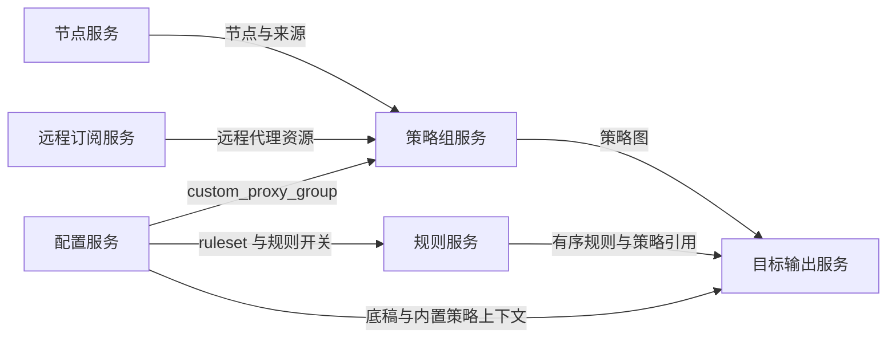

# 规则资源与策略组

## 策略组语法

`config/binding.h` 按反引号分割 custom_proxy_group。前两个字段是名称和类型；普通选择组剩余项为选择器。url-test、fallback、load-balance、smart 从尾部取 URL 与时间参数，其余才是选择器。无效类型或字段不足会跳过该组，不能假定解析必然报错。

[] 前缀表示显式成员引用，正则匹配节点名；!!GROUP、!!GROUPID 选择来源维度，不能与策略组引用混淆。!!PROVIDER= 后按逗号拆分为 UsingProvider，不进入普通 Proxies 数组。TYPE、PORT、SERVER、INSERT 及脚本选择器需按目标评估可表达性。

组名、节点名和 provider 名是不同命名空间，但输出引用最终需要一致。动态远程节点没有可供服务端枚举的名称；显式 use 和节点名正则不能用同一种集合展开算法。

## 规则源

ruleset 将目标策略与源格式分开。源可为内联规则、Surge/QuanX 规则、Clash domain/ipcidr/classic。绑定最终调用 `config/ruleset.cpp::parseRulesetConfigLine`，不是对任意逗号无条件切割。

扩展选项位于 interval 后的 | 分隔段，例如 `策略,clash-ipcidr:https://example.com/ip.yaml,28800|no-resolve`；逗号追加 no-resolve 不是这个扩展语法。stash-format 可指定 yaml/text/mrs，格式属于资源解释方式，不属于策略名。

`generator/config/ruleconvert.cpp::convertRuleset` 先做源格式归一化，再由目标转换器处理类型白名单、策略绑定和 no-resolve。规则顺序具有业务含义；同源重复出现也可能绑定不同策略，不能按 URL 全局去重。

## 不同导出策略

Clash 可内联 rules，也可由 templates.cpp::renderClashScript 生成规则 provider/script 相关结构。规则 provider 文件名有清洗、长度限制和 URL 身份后缀，应独立于代理 provider 命名。

Stash 的 rulesetToStash 保留已有 rule-providers 并检查名称和路径冲突；保留底稿规则时，将 MATCH/FINAL 起的终止段与前段分离，避免新增规则被兜底规则提前截断。非标量底稿规则和无效 provider 结构会失败。资源格式不能安全表达时报告错误。

Surge 家族使用 rulesetToSurge 的目标版本分支，不同客户端支持的规则和远程引用不同。sing-box 使用结构化 JSON 路由转换，不能仅替换规则关键字。

ruleprepend/ruleappend 是扩展的完整 Clash 规则源，保留多源顺序，不能将它们当普通 ruleset 自动附加策略。overwrite_original_rules 决定是否保留原有规则；enable_rule_generator 控制生成流程，两者不是同义开关。

依据：`config/binding.h`、`config/ruleset.cpp`、`generator/config/ruleconvert.cpp`、`generator/config/external_rules.cpp`、`generator/template/templates.cpp`。

## ruleset 与 custom_proxy_group 的交汇



ruleset 的策略字段引用策略符号，不会自动创建 custom_proxy_group。策略可能来自底稿、生成的组、节点或目标内置动作，应按目标可引用的符号集合解析；不能只检查生成组列表。规则编译不负责展开组内节点，组解析也不负责下载规则源。

## 配置组合示例

以下为解释数据依赖的 Clash 配方片段，URL 仅为占位来源：

```ini
[custom]
enable_rule_generator=true
custom_proxy_group=Proxy`select`[]AUTO`[]DIRECT
custom_proxy_group=AUTO`url-test`.*`https://www.gstatic.com/generate_204`300
ruleset=Proxy,clash-domain:https://example.com/domains.yaml,28800
ruleset=DIRECT,[]FINAL
```

该片段由配置服务分别交给策略组服务和规则服务：前者产出 AUTO、Proxy 及成员引用，后者产出指向 Proxy 的域名规则和 DIRECT 兜底规则；目标输出服务结合底稿解析引用。

域名规则的具体输出可为内联条件或远程规则引用，由目标与规则模式决定。改动 AUTO 的节点筛选不要求修改 RuleCompiler；改动规则源格式不要求修改 GroupResolver。这个依赖方向是两模块保持内聚的基础。
