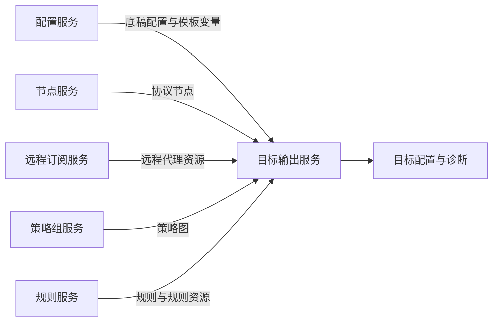

# 目标输出边界

| 输出族 | 底稿与资源职责 |
| --- | --- |
| Clash / ClashR | YAML；Mihomo 输入解析；支持远程代理 provider 与本地节点混合，ClashR 由独立标志影响输出 |
| Stash | YAML；独立远程 provider、规则转换与最终图校验 |
| Surge | INI；版本影响协议、组与 policy-path；规则转换也携带版本 |
| Surfboard | INI；独立 policy-path 能力判定及目标规则语义 |
| Quan / QuanX | INI；Quan 服务端解析，QuanX 可用 server_remote，二者不能共享远程资源语义 |
| Loon | INI；可保留 remote-proxy，并映射组引用 |
| Mellow | INI；服务端解析与目标专用组、规则输出 |
| sing-box | JSON；服务端解析，输出结构化 outbound 与路由；不能当 Clash YAML 转 JSON |
| SS/SSR/VMess/Trojan/VLESS/Hysteria2 等订阅输出 | 以节点输出为主，按协议筛选或混合链接序列；不等于完整路由配置 |

目标注册在 `handler/interfaces.cpp::kTargetDescriptors`，导出集中于 `generator/config/subexport.cpp`；Clash 节点细节另见 clash_proxy.cpp。

完整配置、nodelist、单协议订阅与 mixed 是不同输出模式。即使传入相同模板，节点订阅也不应凭空生成规则和策略组。sssub 的 JSON 底稿语义不能与 URI 订阅编码混用。

重写时每个 exporter 应声明：输入解析器、底稿结构、可输出协议与字段、组类型、规则类型、远程后端及版本条件。协议矩阵应由实际分支推导，不能仅依据 ProxyType 枚举。Base64 包装、URL 编码、换行和 JSON/YAML 序列化分别处理，避免双重编码。

## 目标装配数据流

这是重写时建议的装配分层。目标适配器负责客户端语法；底稿资源选择属于配置策略，传输响应编码属于交付层。三者不应隐藏在同一个节点输出函数中。
