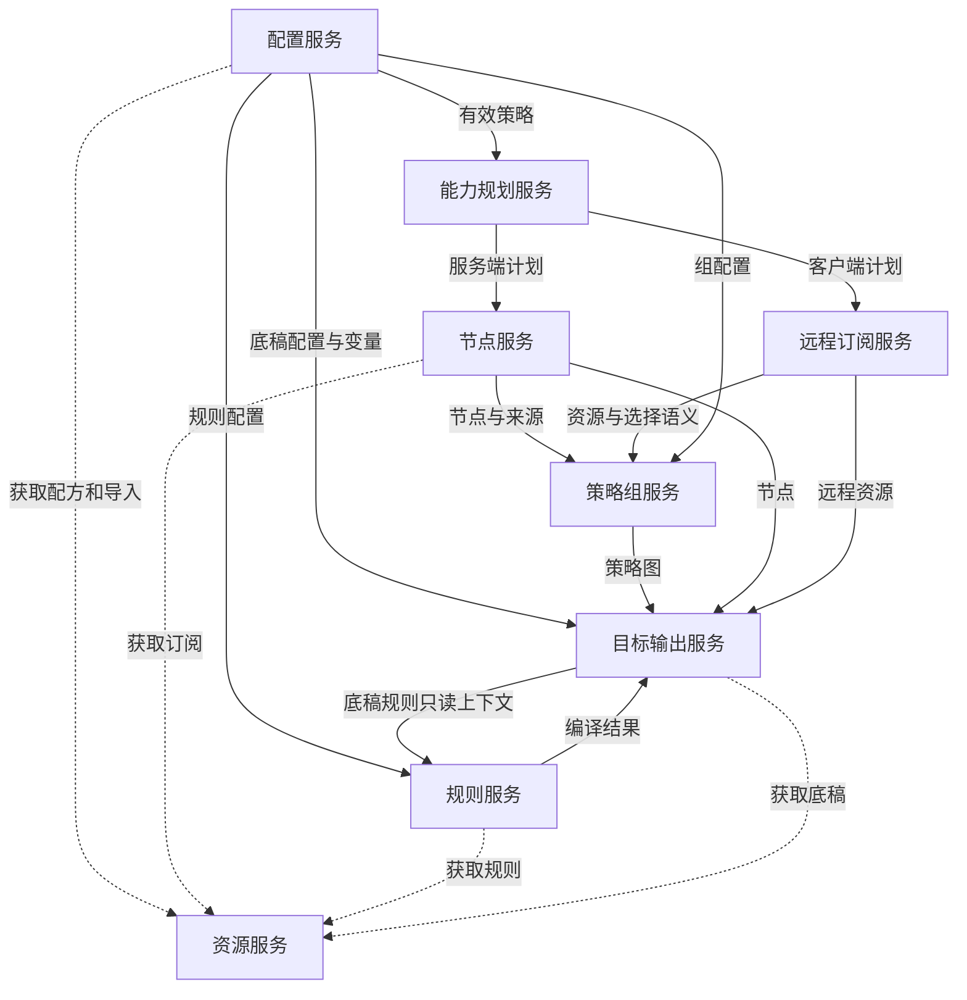

# 可组合的跨语言重写设计

以下为基于现有边界的重写建议，而非当前源码已具备的统一接口。

## 模块契约

| 模块 | 输入 | 输出 |
| --- | --- | --- |
| RequestNormalizer | 参数与客户端身份 | 实际目标、三态选项、来源标签 |
| ResourceResolver | 来源、信任上下文、截止时间、预算 | 内容或结构化获取失败 |
| RecipeRenderer | 配方文本、变量、资源接口 | 已渲染配方 |
| RecipeParser | 已渲染内容、有序重复键 | ExternalRecipe、待导入来源 |
| PolicyResolver | 服务设置、请求、配方 | EffectivePolicy、字段来源 |
| CapabilityPlanner | 目标、策略、输入源 | RemotePlan 或服务端解析计划及原因 |
| NodeParser | 来源内容、解析器能力 | 协议节点、逐节点诊断 |
| NodeTransformer | 节点与节点策略 | 有序节点及名称映射 |
| GroupResolver | 组声明、节点、远程资源 | 策略引用图 |
| RuleCompiler | 有序规则源、目标能力 | 内联规则与远程规则资源 |
| TargetExporter | 底稿、节点、引用图、规则 | 原生目标文档或表达能力错误 |

## 核心数据

SourceId 表示输入身份，不能用清洗后的显示名代替。Source 同时保留原始标签、解码状态和来源序号。Node 包含协议标签、公共端点、协议专属数据、传输、TLS、三态通用开关和来源。RemoteResource 独立保存 requestedName、resourceName、URL、path、interval、headers 与客户端后端。

GroupMember 使用联合类型：节点引用、组引用、内置策略、远程资源引用、动态选择器。RuleSource 保存源格式、绑定策略、选项和顺序；Rule 使用类型化条件与动作，完整规则源另建类型，避免重复附加动作。

资源状态区分未获取、成功空内容、获取失败与不支持格式；布尔值区分未指定与 false。名称映射必须单向生成并贯穿引用解析，不能由各 exporter 重复清洗。

## 组合顺序

先提供配方语法和资源接口，再提供节点模型及服务端解析链路，然后加入规则与策略图，最后逐个增加客户端远程后端。每增加一个远程后端，同时实现能力判定、资源序列化及组引用规则；只实现 provider 输出字段不足以形成完整能力。

纯逻辑模块不依赖 HTTP 框架、文件系统或模板执行器。脚本、模板和网络获取作为可替换能力注入。对正则应声明方言及安全可下推子集；不支持下推时计划降级，不能随意改写表达式。

## 兼容边界

需显式决定是否复刻绑定器跳过无效组/规则的行为、逐节点容错、Mihomo 关闭式失败、客户端字段丢失和名称摘要算法。建议提供兼容模式与严格模式，但两者均报告被跳过或损失的字段。不要承诺通过一个通用 JSON 中间结果即可完成所有客户端转换。

输出前验证引用存在、资源路径唯一、组图无非法循环以及终止规则位置。错误应带阶段、来源和目标，URL 与认证信息脱敏。缓存身份包含解析器能力、设置代次、信任上下文及显式请求头身份；取消与预算贯穿整个执行计划。

## 服务边界与配置归属

以下服务是重写建议中的逻辑模块，可在同一进程内组合，不要求拆成独立网络服务。前文的 Renderer、Parser、Resolver、Compiler 等作为服务内部组件；总流程图仅展示服务级依赖。现有源码集中在 interfaces.cpp、settings.cpp 和生成器中的行为，不能理解为已经按这些服务分离。

| 服务模块 | 配置归属与输入 | 对外产物 | 内聚职责与边界 |
| --- | --- | --- | --- |
| 配置服务 | config、各目标 rule_base、template 变量、全局设置与请求覆盖项 | 有效策略及按领域拆分的配置 | 封装配方渲染、格式识别、导入绑定和字段合成；不解析代理节点或编译路由 |
| 能力规划服务 | target、目标版本、nodelist、有效节点选项、组选择器与来源 | 解析器选择、远程后端、执行计划与原因 | 统一决定哪些行为可下推客户端；不获取订阅或生成目标文本 |
| 资源服务 | 来源描述、FetchContext、缓存策略、预算与截止时间 | 资源内容及来源身份、结构化获取错误 | 统一网络与文件访问、缓存和访问限制；不解释内容的业务含义 |
| 节点服务 | 服务端解析计划；include/exclude、rename、emoji 及节点选项 | 有序协议节点、来源索引和诊断 | 封装解析器适配、节点过滤与变换；不处理未知远程节点，不生成策略组 |
| 远程订阅服务 | 客户端远程计划；provider/tag/interval/UA/headers 等资源参数及可下推过滤 | 远程代理资源、名称映射与选择语义 | 封装目标远程后端差异、资源身份和客户端变换描述；不展开尚未获取的节点 |
| 策略组服务 | custom_proxy_group、节点集合、来源索引和远程代理资源 | 策略图与待解析引用 | 封装组类型、成员选择及远程成员关联；不加载规则内容 |
| 规则服务 | ruleset、enable_rule_generator、overwrite_original_rules、ruleprepend/ruleappend、目标能力及底稿规则上下文 | 有序规则、规则资源和策略引用 | 封装源格式、规则选项、顺序及目标规则投影；不创建引用的策略组 |
| 目标输出服务 | 底稿配置与变量、节点、远程资源、策略图和规则结果 | 原生文档、编码结果与诊断 | 封装原生底稿解析、目标装配、引用解析与目标校验；不重新决定节点或远程后端计划 |

同一字段可以被多个服务读取，但业务语义只由归属模块解释。配置服务只做语法绑定和合成，不重复实现领域逻辑。例如 rename 的节点变换由节点服务执行，远程可表达性由能力规划服务判断，下推后的资源描述由远程订阅服务生成。

规则服务需要底稿的已有规则和规则资源上下文；目标输出服务应提供解析后的只读视图，再接收编译结果装配。此依赖不表示规则服务直接修改目标输出服务的可变文档。组引用校验同样需要底稿中的已有策略，不能仅依赖本次生成的组。

实线表示业务数据依赖，虚线表示资源调用。规则服务与目标输出服务之间为分阶段调用：先读取底稿上下文，再编译规则，最后装配；不应实现成相互递归调用。资源服务也可由编排层预取后注入，其调用关系不改变领域配置归属。

## 独立模块拆解约束

后续为单个服务绘制内部小图时，只展开该服务拥有的处理步骤，其他服务保留为输入输出端点。内部图需明确配置进入点、主要数据形态和失败出口；总览图不加入解析器、缓存、命名函数或序列化字段等内部节点。

每个服务对外契约包含输入配置、业务数据、目标能力与结构化诊断；请求快照、取消和预算通过统一执行上下文传入。目标适配器作为节点、远程资源、规则和输出服务内部的可替换实现，不复制整个编排流程。

服务拆解以配置语义和数据不变量为边界：规则类型扩展应集中影响规则服务与目标规则适配器；组选择器扩展应集中影响策略组服务与能力规划；新远程后端应提供能力判断、资源描述和输出适配，复用其他领域服务。新增客户端不得通过在所有服务中散布目标字符串判断来接入。
