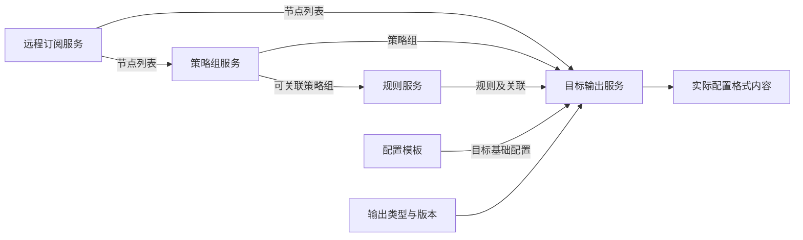

# 五模块组合设计

本组文档按远程订阅服务、策略组服务、规则服务、配置模板、目标输出服务重新划分重写边界。它是面向跨语言实现的设计契约，不表示原项目已经按此结构实现。原项目依据与兼容差异见[源码分析索引](../README.md)。

本设计中的远程订阅服务获取并解析订阅，返回实际节点列表。它与原分析中“保留订阅 URL 交给客户端加载”的远程订阅服务含义不同；客户端 proxy-provider、server_remote、policy-path 不属于本设计的核心输入输出契约。

| 模块 | 文档 | 核心产物 |
| --- | --- | --- |
| 远程订阅服务 | [订阅获取与解析](01-subscriptions.md) | 有序节点列表及来源 |
| 策略组服务 | [策略组与成员](02-groups.md) | 策略组集合及成员引用 |
| 规则服务 | [规则集与策略关联](03-rules.md) | 有序规则集、绑定及终止规则 |
| 配置模板 | [模板与合并边界](04-templates.md) | 目标原生基础配置 |
| 目标输出服务 | [目标适配与装配](05-output.md) | 实际客户端配置文本 |

共享的数据契约、调用方式及配置归属见[组合契约](06-composition.md)。模块是进程内逻辑边界，不要求各自部署 HTTP 服务。

规则可以先独立定义，再绑定策略组；图中的组到规则依赖表示关联校验需要组身份，不要求先下载订阅才能编辑规则。执行时节点、组成员和引用必须在输出前解析完整。
