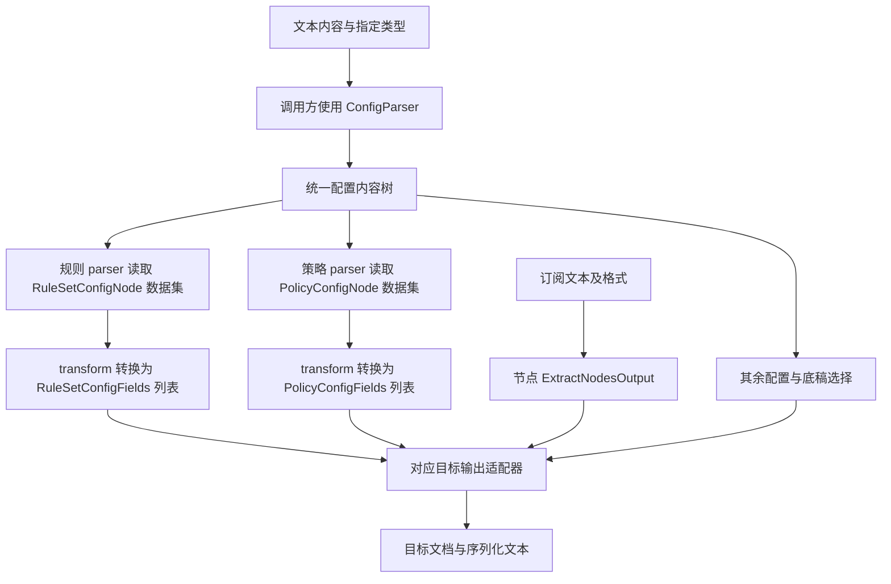

# Subconverter 解析与输出契约

转换模块与工作流节点共用的数据契约定义在 `lib/subconverter/types/`；转换模块不得依赖 `lib/workflow/flows/` 下的节点实现或类型。

本文档组以本仓库当前工作区源码和 SubConverter-Extended 源码为依据。`SCE` 在文中指 `/Users/larify/Documents/github/SubConverter-Extended`；引用路径均相对其仓库根目录。既有分析见 [subconverter-extend](../subconverter-extend/README.md)。

## 实现边界

订阅解析、配置语法解析、规则解析与策略解析分别处理自身职责。配置语法层提供 `ConfigObject`；策略与规则 parser 分别读取配置数据集并转换为通用定义数组。订阅 provider 的节点转换不等于完整客户端配置输出能力。

策略与规则模块使用普通函数：公开入口为 `parse(configuration)`，内部 `transform` 负责转换。调用方可以别名导入为 `parseRules`、`parsePolicies`，无需创建解析器实例。完整输出适配器的装配类型与流程属于独立接口约束。

## 解析公共约束

- policies、rulesets 节点通过 Combobox 显式选择 INI、YAML 或 TOML，默认 INI；既有空配置按 INI 兼容处理。文件名、后缀和内容不参与格式猜测。
- 已消费对象字段须按各模块契约收窄，null、错误形状与非法多值抛出配置字段错误；未知字段留在原始配置树，不自动增加到通用输出。
- 明确作为数字消费的值必须完整匹配非负安全整数文本，不使用 parseInt 截断；未提供的值按各配方约定处理。INI 策略时间组合中空的可选分量视为未提供，非空分量仍须严格校验。
- 配方容错和默认值按各解析文档记录的 SCE 行为处理；严格数字、未展开导入及通用类型无法表达的状态遵循本模块边界，不声称逐字节兼容 SCE。
- 节点执行器将语法与配置字段错误转换为既有配置解析业务错误；业务 parser 不调用工作流服务，不修改传入配置树。

## 解析文档

| 文档                                | 边界                                                                                                        |
| ----------------------------------- | ----------------------------------------------------------------------------------------------------------- |
| [配置解析](configuration.md)        | INI、YAML、TOML → 统一语法内容树；不解释业务                                                                |
| [规则解析](rules.md)                | 规则 parser：配置对象 → RuleSetConfigNode 数据集 → `RuleSetConfigFields[]`，结构兼容现有 `RuleGroupsOutput` |
| [策略解析](policies.md)             | 策略 parser：配置对象 → PolicyConfigNode 数据集 → `PolicyConfigFields[]`，结构兼容现有 `PolicyGroupsOutput` |
| [节点解析](nodes.md)                | 订阅文本 → 现有 `ExtractNodesOutput`                                                                        |
| [其余配置](other-options.md)        | 三要素之外的配置及归属                                                                                      |
| [配置输出适配器](output-adapter.md) | 三要素分别 transform → combine 配置对象 → toString 文本                                                     |



## 输出文档范围

配置输出适配器要求支持 `clash/clashr`（Mihomo）、`surge`、`quanx`、`loon`、`surfboard`、`stash`、`singbox`。统一方法、泛型类型及转换依赖见[配置输出适配器](output-adapter.md)。下列其他格式文档属于已有格式分析，不代表本次适配器也要求实现这些输出。

本仓库现有 provider 对应：[clash](outputs/clash.md)、[sing-box](outputs/sing-box.md)、[surge](outputs/surge.md)、[surfboard](outputs/surfboard.md)、[loon](outputs/loon.md)、[quanx](outputs/quanx.md)、[ini](outputs/ini.md)、[uri](outputs/uri.md)、[base64](outputs/base64.md)、[ss](outputs/ss.md)、[ssr](outputs/ssr.md)、[v2ray](outputs/v2ray.md)。其中后三种 provider 的配置形态不能直接等同于 SCE 同名链接输出。

SCE 另外注册的目标对应：[clashr](outputs/clashr.md)、[stash](outputs/stash.md)、[quan](outputs/quan.md)、[mellow](outputs/mellow.md)、[ssd](outputs/ssd.md)、[sssub](outputs/sssub.md)、[v2rayn](outputs/v2rayn.md)、[v2rayng](outputs/v2rayng.md)、[shadowrocket](outputs/shadowrocket.md)、[trojan](outputs/trojan.md)、[vless](outputs/vless.md)、[hysteria2](outputs/hysteria2.md)、[mixed](outputs/mixed.md)。这些目标在本仓库没有独立 provider，不得以本仓库已支持的名义调用。SCE 的 `singbox` 对应本文的 `sing-box`。

依据：本仓库 [SubscriptionFormat](../../lib/subconverter/types/subscription.ts)、[SubscriptionProvider](../../lib/subconverter/providers/provider.ts)；SCE `src/handler/interfaces.cpp::kTargetDescriptors`。

## 输出公共契约（目标）

以下契约描述包含底稿、选项和扩展资源的完整输出目标；当前工作流入口及实现边界见[订阅生成节点](output-adapter.md#订阅生成节点)。三要素的字段定义仅以源码为准，不另建替代领域模型。

```ts
import type { PolicyConfigFields, ProxyNodeFields, RuleSetConfigFields } from '@/lib/subconverter/types';
type JsonValue = null | boolean | number | string | JsonValue[] | { [key: string]: JsonValue };
type NativeObject = { [key: string]: JsonValue };
interface OutputInput<B, O> {
  rules: RuleSetConfigFields[];
  policies: PolicyConfigFields[];
  nodes: ProxyNodeFields[];
  base: B;
  options: O;
}
interface OutputOptions {
  enableRuleGenerator: boolean;
  overwriteOriginalRules: boolean;
  unsupported: 'error' | 'skip';
  emptyGroup: 'error' | 'direct';
}
interface NodeOnlyOptions {
  nonNodeElements: 'error' | 'ignore';
  unsupported: 'error' | 'skip';
}
interface SymbolBinding {
  kind: 'node' | 'group' | 'builtin';
  inputName: string;
  outputName: string;
}
interface ResolvedPolicy {
  definition: PolicyConfigFields;
  members: SymbolBinding[];
  providers: string[];
}
interface MaterializedRuleSource {
  index: number;
  definition: RuleSetConfigFields;
  lines: string[];
}
interface OutputIssue {
  stage: 'node' | 'policy' | 'rule' | 'assembly';
  index?: number;
  field?: string;
  message: string;
}
interface ConfigArtifact<D> {
  target: string;
  document: D;
  mediaType: string;
  content: string;
  issues: OutputIssue[];
}
```

`base` 是已经加载并完成模板渲染的原生底稿，不是外部配方。完整配置目标必须保留底稿中未由本目标接管的字段。`NativeObject` 用于这些未接管区域；各目标的三要素区域另行收窄类型。原生节点的完整协议联合直接引用现有源码；文档中的结构不声称覆盖客户端全部配置项。

现有 `RuleGroupsOutput/PolicyGroupsOutput` 分别与 `RuleSetConfigFields[]/PolicyConfigFields[]` 结构等价；各输出文档统一使用后者，表示 transform 转换后的通用字段数组。通用业务类型由 `lib/subconverter/types/` 声明，转换模块、相关 service 和 workflow 直接引用；节点专属配置与运行类型保留在节点模块，通用编排类型保留在 `lib/types/workflow.ts`。

节点订阅目标使用 `NodeOnlyOptions`：规则或策略数组非空时，默认拒绝；只有 `nonNodeElements=ignore` 才明确舍弃并返回诊断，不下载规则源、不展开策略成员。协议过滤与三要素舍弃是两个独立决定。目标文档中的原生行、链接与 JSON 对象均为装配结构定义，不表示现有 provider 已有文本序列化方法。

### 共同处理约束

1. 按目标转换节点后建立名称映射，再展开策略成员。现有 `transform('node', nodes)` 会跳过无效或不支持的节点，并过滤缺失、歧义或循环的 `underlyingProxy` 依赖；目标装配器须捕获这种丢失并按 `unsupported` 决策，不能把转换成功的数组当作完整输入。
2. `reference` 按名称绑定节点、策略或目标内置动作；`selector` 对本次可输出节点求值，顺序遵循定义与节点输入顺序。`id` 可选，不能假设节点或策略已有必填的稳定 ID。名称歧义、缺失、组循环均须处理；`providers` 引用底稿中已有资源，不因来源 URL 自动创建资源。
3. 规则内联项生成单条条件；远程项按 `format` 获取和归一化。保留规则定义顺序及每个资源内的顺序，使用 `policy` 查目标符号。可以复用下载结果，不得按 URL 去掉不同绑定。`MaterializedRuleSource.lines` 尚未附加目标策略，不能复用带旧策略的完整规则。
4. 规则生成关闭时不获取这些规则源；覆盖开关只决定对应目标规则区的合并方式。终止规则、底稿规则与新增规则的次序由目标文档规定。`ruleprepend/ruleappend` 属于独立完整规则源，见[其余配置](other-options.md)。
5. 规则引用、组成员、远程资源、名称冲突与目标字段能力在序列化前校验。无法表达时默认报错；显式跳过后再次校验引用。空组补 DIRECT、fallback 降为测速等必须是明确的兼容决定。
6. 成功才返回 `ConfigArtifact`；错误含阶段、输入索引或字段。JSON/YAML/INI 结构校验、字段名投影和文本编码分别执行；不能直接对现有 camelCase 节点对象做序列化来替代原生字段投影。

节点转换依据：[createTransform](../../lib/subconverter/proxy-node/transform.ts)。规则格式依据：SCE `src/generator/config/ruleconvert.cpp::convertRuleset`；策略选择依据：SCE `src/generator/config/subexport.cpp::applyMatcher/groupGenerate`。各输出文档只补充对应目标的差异。
