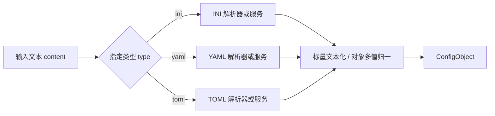

# 配置解析

## 输入、输出与职责（目标）

输入内容为纯文本，通过显式指定的 `type: 'ini' | 'yaml' | 'toml'` 选择对应解析器或解析服务。文件名、文件后缀和内容特征均不参与类型选择。指定类型缺失或不受支持时返回参数错误；解析失败时返回对应类型的语法错误，不尝试其他解析器。

输出为统一的 `ConfigObject`。只消除文件语法差异：解析 section、table、mapping、sequence 和标量；不解释字段的业务含义，不加载外部资源、展开导入、渲染模板或执行脚本，不注入业务默认值。

```ts
type ConfigValue = string | null | ConfigObject | ConfigValue[];
interface ConfigEntry {
  key: string;
  values: ConfigValue[];
}
interface ConfigObject {
  entries: ConfigEntry[];
  isolated: string[];
}
type ConfigType = 'ini' | 'yaml' | 'toml';
interface ConfigParser {
  parse(content: string, type: ConfigType): ConfigObject;
}
interface ConfigSyntaxError {
  type: ConfigType;
  line: number;
  column: number;
  message: string;
}
```

所有标量除显式 null 外统一为文本，不提前转为 JS number 或 boolean。布尔字面量转规范文本 `true/false`，整数为十进制文本，日期时间保留语法解析后的标准文本；大整数不得经 JS number 丢失精度。非有限数保留为文本。字符串按各格式规则解引号、转义，不再对其内容作全局 trim。空字符串、null、缺失键和空数组必须区分。

`entries` 按键首次出现的顺序排列；同键多值按出现顺序放进 `values`。对象属性的一层序列直接成为 `values`，标量或对象成为单元素 `values`；嵌套序列仍是 `ConfigValue[]`。因此 `a=x` 与 YAML/TOML 的 `a: [x]`/`a=["x"]` 得到相同的内容模型；此模型不保留“单个值还是单元素数组”的原始排版区别。空序列为 `values: []`，空字符串为 `values: [""]`。

同一对象内的重复 INI 键累加，YAML/TOML 重复键按格式规范报错。INI section 与 TOML table 均为根对象下的 `ConfigObject`；重复 INI section 合并。INI 无 section 的内容留在根对象，不补默认 section。INI 孤立行放进该对象的 `isolated`；其他格式通常为空。该模型保证键值与孤立行各自有序，不保证二者交错位置，因此不是可逐字往返的 CST。

YAML 根必须为 mapping；多文档流、非字符串映射键和自定义标签拒绝。别名需有展开数量、深度及循环限制。TOML 数组表变成对象多值；点分键按 TOML 语义建立对象，不按业务路径猜测。INI 只在首个赋值分隔符切开，URL、正则、反引号及后续等号保持内容；整行注释按格式处理，不直接截断值中的 `#`、`;` 或 `//`。

## 三格式同结构示例

```ini
[section]
enabled=false
label=one
label=two
```

```yaml
section:
  enabled: false
  label: [one, two]
```

```toml
[section]
enabled = false
label = ["one", "two"]
```

以上均得到：

```json
{
  "entries": [
    {
      "key": "section",
      "values": [
        {
          "entries": [
            { "key": "enabled", "values": ["false"] },
            { "key": "label", "values": ["one", "two"] }
          ],
          "isolated": []
        }
      ]
    }
  ],
  "isolated": []
}
```

解析保留配置中原有的键名与层级，不重命名字段或移动字段路径。


