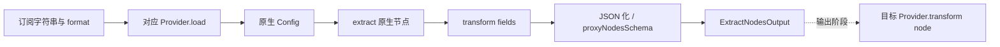

# 节点解析

## 现有接口

以[订阅解析节点](../../lib/workflow/nodes/subscription/nodes/extract-nodes/model/types.ts)为准：输入是订阅字符串，配置中的 `format` 为 `SubscriptionFormat`，输出 `ExtractNodesOutput = ProxyNodeFields[]`。节点不从外部配方的 `custom` 中推导，也不附带规则和策略。

`ProxyNodeFields` 是按 `type` 区分的协议联合，定义于 [proxy-node/fields.ts](../../lib/subconverter/types/proxy-node/fields.ts)，协议细节在同目录 `protocols` 中维护；本文不重复枚举协议或字段。基础名称与可选来源信息见 [common.ts](../../lib/subconverter/types/proxy-node/common.ts)。`id/sourceId/groupId/group` 可选，解析结果不能假设一定具有这些字段。

## 处理过程

[parsing.ts](../../lib/workflow/nodes/subscription/runtime/parsing.ts) 去 BOM、首尾空白后按显式格式选择 provider。`load` 解析原生配置并提取节点，`transform('fields', provider.nodes)` 转为统一字段，经过 JSON 化与 `proxyNodesSchema` 校验后输出。

输入格式不决定输出格式。Clash 输入提取代理，不返回策略与规则；sing-box 输入过滤 direct/block/dns/selector/urltest 等动作，并纳入可支持的 endpoints。INI 系列保留原配置 section 供 provider 使用，但订阅解析节点最终只返回节点数组。Base64 在解码后还需选择内部 URI 或 INI 结构。

## 边界

provider 的 `supports` 与字段转换约束共同决定可转换能力，不能只看协议枚举。现有转换器可跳过不支持、无效、字段无法表达或存在非法依赖的节点；空数组并不自动等于顶层解析失败。顶层抛出的失败映射到 `workflow.SUBSCRIPTION_PARSE_FAILED`，逐节点原因通过转换调试通道记录。

完整输出需要规则定义与策略定义作为独立输入，不能从这份数组恢复原订阅中的其他区域。输出的节点过滤结果必须反向约束策略选择与规则引用，见[公共输出约束](README.md#共同处理约束)。
