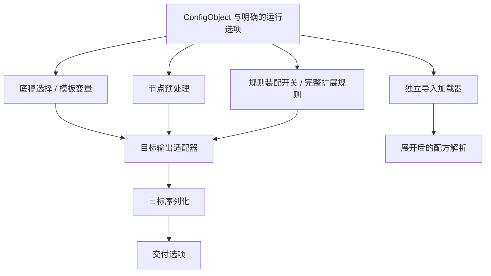

# 其余配置

## 保留结构与消费边界

除[规则定义](rules.md)、[策略定义](policies.md)、[节点](nodes.md)外，配方中的其他内容统一保留在[配置树](configuration.md)内，由各消费方读取；不混入三个现有输出数组。未知键保留原路径和值，不能因为当前未消费就删除，也不能直接下放为任意目标客户端字段。

本文件覆盖 SCE 外部配方、与三要素装配直接相关的请求/运行选项，以及全局设置的归属边界；全局服务设置不是外部配方可任意覆写的字段。字段来源依据 `src/handler/settings.cpp::loadExternalYAML/loadExternalTOML/parseExternalConfigContent`、`src/handler/interfaces.cpp` 与 `src/config/preference_file.*`。

## 底稿与模板

| 内容                        | 归属与处理                                                                                                                              |
| --------------------------- | --------------------------------------------------------------------------------------------------------------------------------------- |
| `*_rule_base`               | 按目标选择原生底稿，包括 Clash、Surge、Surfboard、Mellow、Quan、QuanX、Loon、SSSub、sing-box、Stash；先加载、模板渲染，再交给目标装配器 |
| INI `[template]`            | 读取为后续底稿使用的 local_vars                                                                                                         |
| YAML 根 `template_args`     | `key/value` 列表                                                                                                                        |
| TOML `custom.template_args` | `key/value` 表列表；原实现对 value 使用 TOML 格式化，不能假设与 YAML 文本化完全相同                                                     |
| `version`                   | TOML 配方格式识别标志，不是客户端目标版本                                                                                               |

配方自身渲染先于配方变量提取；变量不能反向改变已渲染的同一配方。原生底稿与外部配方不是同一种 Config；不将 JSON 底稿强塞入三种外部配方格式。

## 节点预处理选项

| INI / 结构化字段                          | 处理含义                                       |
| ----------------------------------------- | ---------------------------------------------- |
| `include_remarks/exclude_remarks`         | 节点名称筛选，必须在策略 selector 展开之前完成 |
| `rename` / `rename_node`                  | 重命名规则；INI 以最后一个 `@` 分隔匹配与替换  |
| `emoji` / YAML `emojis` / TOML 根 `emoji` | 表情规则；INI 用最后一个逗号分隔               |
| `add_emoji/remove_old_emoji`              | 表情开关，缺省与显式 false 区分                |

脚本形式的重命名、过滤或组选择由独立执行能力处理，不属于配置语法解析。排序、去重、UDP/TFO、证书校验覆盖等若来自请求或全局配置，应形成明确的节点预处理/输出选项，不能凭一个同名外部配方键就推定 SCE 已支持覆写。

## 规则装配选项

| 字段                       | 消费阶段                                                                                     |
| -------------------------- | -------------------------------------------------------------------------------------------- |
| `enable_rule_generator`    | 控制是否执行规则源获取与目标规则生成；不删除规则定义本身                                     |
| `overwrite_original_rules` | 决定目标规则区保留策略，具体动作见对应输出文档                                               |
| `ruleprepend/ruleappend`   | 完整 Clash 规则源，按多源顺序分别加入前部与后部；已经带策略，不能当普通规则源再次附加 policy |

前后置完整规则需独立获取、逐条校验并按 SCE `src/generator/config/external_rules.cpp::mergeClashRules` 的终止规则处理逻辑合并。它们不在 `RuleGroupFields` 中表达，不能静默套用到非 Clash 目标。Stash 的底稿终止段处理不等同于默认支持这两个扩展。

## 策略扩展与远程代理资源

SCE 策略对象中的 `strategy/lazy/disable-udp/persistent/evaluate-before-use` 超出现有策略输出类型。它们是策略附属参数，不是目标无关的全局选项：仍按原路径保留；如果请求的目标需要消费，必须先显式扩展策略类型和解析能力，否则报告能力缺口，不能在“其余配置”里偷偷拼回生成组。

远程代理 provider、`policy-path`、QuanX `server_remote`、Loon `Remote Proxy` 是客户端运行时资源。现有三要素输入没有这些资源的 URL、headers、健康检查等描述；`PolicyGroupFields.providers` 只能引用底稿中已存在的资源。输出文档提及 SCE 动态生成远程资源时仅说明原行为；若重建该能力，需要独立的资源输入类型。服务端已解析的节点不能自动恢复成客户端远程订阅。

## 加载与运行参数

`!!import:` 和对象 `import` 是片段加载指令。解析配置树只保留文本/对象；独立加载器负责获取、作用域限制、大小/数量/递归限制、按原位置展开，以及 Fetch/Render/Parse/Import 各阶段错误。存在动态 import/script 时不能沿用普通静态内容缓存身份。

目标版本、nodelist、远程规则服务前缀、Clash provider/script 模式、sing-box WireGuard schema、Snell 开关、兼容跳过及空组策略，属于输出选项；managed-config、Base64 包装、下载文件名与 HTTP 响应头属于目标文本或交付选项。它们的适用性按目标验证，不进入规则或策略定义数组。

监听、鉴权、缓存、代理抓取通道、全局资源预算、定时任务、上传和日志属于服务配置或交付服务；外部配方没有默认写权限。本文不重复维护全局设置字段清单。

