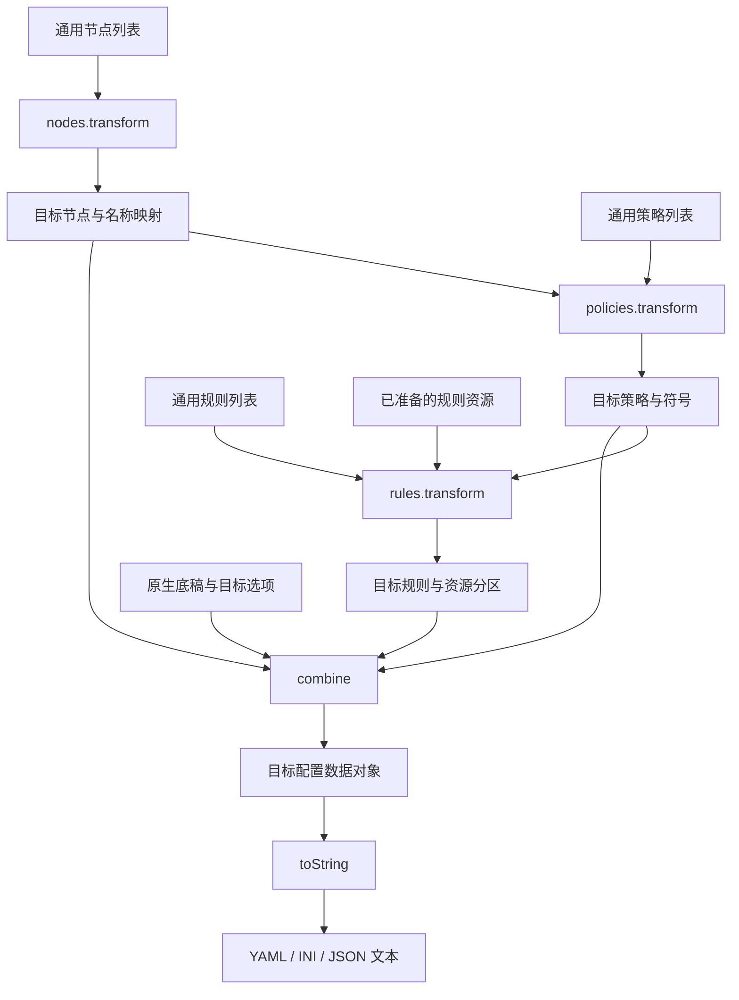

# 配置输出适配器

## 职责与支持范围

输出适配器接收已经转换为通用类型的节点、规则和策略列表，分别转换为目标格式的数据，再由 `combine` 组合为完整配置对象，最后通过 `toString` 输出文本。此文定义完整输出适配器的目标接口；工作流入口的已实现边界见[订阅生成节点](#订阅生成节点)。

| 软件 / 输出类型          | 适配器标识     | 三要素转换与最终配置结构                |
| ------------------------ | -------------- | --------------------------------------- |
| Mihomo / Clash           | `clash`        | [Clash](outputs/clash.md)               |
| Mihomo / ClashR 兼容输出 | `clashr`       | [ClashR](outputs/clashr.md)             |
| Surge                    | `surge`        | [Surge](outputs/surge.md)               |
| Quantumult X             | `quanx`        | [QuanX](outputs/quanx.md)               |
| Loon                     | `loon`         | [Loon](outputs/loon.md)                 |
| Surfboard                | `surfboard`    | [Surfboard](outputs/surfboard.md)       |
| Stash                    | `stash`        | [Stash](outputs/stash.md)               |
| sing-box                 | `singbox`      | [sing-box](outputs/sing-box.md)         |
| Shadowsocks(SS)          | `ss`           | [SS](outputs/ss.md)                     |
| Shadowsocks(Mixed)       | `mixed`        | [Mixed](outputs/mixed.md)               |
| Shadowrocket             | `shadowrocket` | [Shadowrocket](outputs/shadowrocket.md) |

`clash/clashr` 是不同输出能力约束，不能仅按软件名称选用相同字段。本文采用 `singbox` 作为输出适配器标识；现有订阅解析格式 `sing-box` 与文档文件名 `outputs/sing-box.md` 保持不变，在输出入口显式映射。其他输出文档保留格式分析，不属于本适配器要求的支持范围。

## 订阅生成节点

[订阅生成节点](../../lib/workflow/flows/subscription/generate-subscription-node/index.ts) 接受通用节点、规则和策略三类列表。每类均可缺省，但至少连接一个来源；已连接来源可以输出空列表。同类多个来源按连线顺序追加，保留列表内部顺序，不默认去重。

执行上下文按输入顺序携带来源节点标识和根据其配置解析后的输出类型。节点以数组元素的具名类型及版本识别类别，并再次按对应 schema 校验，分别组装为 `nodes`、`rulesets`、`policies`；未连接的类别不创建 key，已连接的空列表保留为空数组。类型不能唯一归类时失败，不依赖节点名称或数组内容猜测来源。

聚合对象只用于单次执行，不写入配置草稿。调用[输出入口](../../lib/subconverter/output/index.ts) 时，缺省列表补为空数组，`rulesets` 显式映射为适配器的 `rules`。节点配置仅选择输出类型，默认 Clash；输出为完整配置的 String，适配器内部保留配置对象、媒体类型和诊断。

当前入口从空底稿生成配置；不接收原生底稿、版本切换、模板、远程代理 provider 定义或有损字段降级选项。目标无法表示的协议、字段或参数组合默认过滤整个节点，依赖缺失、歧义或循环的节点同步过滤；过滤项记入产物诊断，保留原输入位置及其余节点顺序，允许全部过滤后输出空节点列表。节点名称为空或重复、空策略组、策略或规则中的缺失引用、循环策略引用及不支持的规则条件仍失败。策略成员筛选与引用绑定以过滤后的节点为准。来源节点元数据仅供选择器使用，不作为原生协议字段输出。

纯节点目标 `ss`、`mixed`、`shadowrocket` 忽略传入的策略和规则，不获取远程规则；节点过滤遵循上述通用边界。三者使用 URI 转换器生成分享链接，`document` 为链接数组，`content` 为逐行链接文本的 UTF-8 Base64 编码，媒体类型为 `text/plain`。SS 可将加密方式兼容且 `protocol=origin`、`obfs=plain` 的 SSR 转为 SS；Mixed 和 Shadowrocket 保留 SSR 链接。Shadowrocket 沿用本仓库的 URI 订阅格式，不采用 Sub-Store 同名 producer 的 YAML 格式。

所有目标的可选节点参数按输入保留：输入字段有值且目标支持时，映射为目标原生字段；输入未提供时不补写默认值，显式 `false`、`0` 和空字符串不能因 truthy 判断丢失。字段存在以值不为 `undefined` 判断。格式必需的结构、协议判别和等价字段转换仍由目标序列化器生成。格式无法表示的参数遵循目标能力边界，不伪造扩展字段；Sub-Store 参考文档中的默认补值或仅 true 输出规则不覆盖本约束。

节点输出先依据 [Sub-Store 格式与参数表](sub-store/README.md)确定目标 schema、协议字段、类型与缺省行为；未覆盖的能力再核对协议或客户端的最新官方规范。不同应用的目标名称须按映射表解释，不将 SubConverter-Extended 的目标与 Sub-Store 同名 producer 直接视为相同结构。

UDP、TFO、UOT 按[目标与协议的字段对照](sub-store/README.md#udp-参数对照)分别输出。SS URI 支持 `udp=0/1` 扩展，Base64 包装不改变内层字段能力；不得统一丢弃这些参数，也不得把某个协议的扩展机械追加到所有节点。

远程规则在转换前按声明格式获取并归一化，下载响应运行取消信号；能够原生消费的 Clash 系列规则资源可直接生成 rule-provider。非原生二进制资源、需要额外上下文的选择器、SSID 组，以及目标无法表示的测速参数或 `no-resolve` 均失败。sing-box 使用 WireGuard endpoint 与路由 action，不生成旧版 outbound；GEOSITE 和非 private GEOIP 所需的规则资源地址未配置时拒绝生成。各目标的底稿合并、可选兼容模式及其他扩展能力仍按下文目标接口约束，不由当前节点隐式启用。

## 三要素与上下文

通用字段定义及错误、符号、规则资源类型引用[公共契约](README.md#输出公共契约目标)，不再次解析外部配方或调用规则、策略 parser。

```ts
import type { OutputTarget } from '@/lib/subconverter/types/output';
import type { ProxyNodeFields } from '@/lib/subconverter/types/proxy-node';

interface OutputElements {
  nodes: readonly ProxyNodeFields[];
  rules: readonly RuleSetConfigFields[];
  policies: readonly PolicyConfigFields[];
}
interface ConvertedNode<N> {
  sourceIndex: number;
  fields: ProxyNodeFields;
  value: N;
  symbol: SymbolBinding;
}
interface ConvertedNodes<N> {
  entries: ConvertedNode<N>[];
  issues: OutputIssue[];
}
interface ConvertedPolicies<P> {
  value: P;
  symbols: SymbolBinding[];
  issues: OutputIssue[];
}
interface ConvertedRules<R> {
  value: R;
  issues: OutputIssue[];
}
interface OutputContext<B, O> {
  base: B;
  options: O;
  symbols: readonly SymbolBinding[];
  ruleSources: readonly MaterializedRuleSource[];
}
interface OutputParts<N, R, P> {
  nodes: ConvertedNodes<N>;
  rules: ConvertedRules<R>;
  policies: ConvertedPolicies<P>;
}
```

`N/R/P` 分别为目标节点对象、规则分区、策略分区；后两者可以包含附属资源，并不要求是单一数组。`B` 是原生底稿，`O` 是目标选项。底稿、选项和资源属于装配上下文，不加入三要素字段类型。

`ConvertedNode.fields` 保存与该输出节点对应的通用字段，供策略 selector 求值；`value` 是已经完成原生字段投影的目标节点。`sourceIndex` 标识原列表位置，允许一条输入生成多个目标节点，也允许显式跳过后不产生条目。不能将原列表与转换后列表按数组下标直接配对。

规则资源服务负责按远程定义获取正文、归一源格式，并通过 `ruleSources` 交付；可由客户端直接引用的资源保留定义供目标转换。该服务按生成开关运行，`transform/combine/toString` 不执行网络获取、模板渲染或脚本。资源获取与定义解析的边界沿用[规则文档](rules.md)和[其余配置](other-options.md)。

## 适配器契约

适配器由模块导出的函数组合构成，不要求定义 class 或维护可变实例。三类转换在职责上分开，但策略转换依赖实际输出节点，规则转换依赖可引用的目标符号，因此不得无条件并行执行。

```ts
interface OutputAdapter<N, R, P, D, B, O> {
  readonly target: OutputTarget;
  readonly mediaType: 'text/yaml' | 'text/plain' | 'application/json';
  nodes: {
    transform(nodes: OutputElements['nodes'], context: OutputContext<B, O>): ConvertedNodes<N>;
  };
  policies: {
    transform(
      policies: OutputElements['policies'],
      nodes: ConvertedNodes<N>,
      context: OutputContext<B, O>,
    ): ConvertedPolicies<P>;
  };
  rules: {
    transform(rules: OutputElements['rules'], context: OutputContext<B, O>): ConvertedRules<R>;
  };
  combine(parts: OutputParts<N, R, P>, context: OutputContext<B, O>): D;
  toString(config: D): string;
}
```

`nodes/policies/rules` 是同一目标下的转换模块命名空间，各自导出 `transform`；不能把三个同名函数混在同一作用域。`combine/toString` 由目标适配器导出并聚合。泛型约束保证该目标的转换结果只能交给对应的组合与序列化过程，调用方不以 `unknown` 或强制断言混接其他目标。

`D` 必须是完整配置数据对象，而非订阅文本或只包含三要素的包装。JSON/YAML 目标直接包含原生配置区域；INI 目标使用对应文档的有序 `sections` 配置对象。配置对象不要求拥有成员方法，`toString` 是适配器方法，调用形式为 `adapter.toString(config)`。

## 转换、组合与输出顺序

1. 按目标选择适配器及明确的版本选项，加载、渲染原生底稿，校验底稿形状；从底稿提取既有内置动作、节点、组及资源符号。
2. `nodes.transform` 转换通用节点，处理协议能力、名称、字段和节点依赖，返回实际输出节点与映射；转换丢失按明确选项报告或失败。
3. `policies.transform` 在实际输出节点上匹配 selector，将 reference/providers 绑定到节点、策略、内置动作和已有资源，生成目标策略分区与符号；校验空组、循环和有损组行为。
4. 更新上下文符号表，再由 `rules.transform` 转换通用规则定义及已准备的规则资源，绑定目标策略，生成目标规则分区、兜底和必要资源引用。规则生成关闭时不转换这些定义，不获取其资源。
5. `combine` 按目标文档将三个分区与底稿组装为 `D`，处理覆盖、保留、名称冲突、附属配置与终止规则次序，并完成最终引用校验。
6. `toString` 只将已完成组合及校验的 `D` 序列化为目标文本，不补组、不绑定引用、不改写规则、不重新执行三要素转换。

规则正文获取可以在依赖允许时提前完成，但不能改变以上转换的数据依赖。各阶段不修改调用方的列表或底稿；转换产物承载所有必要附属配置，`combine` 不回到原始文本中重新推导。

以下是核心同步转换接口的调用示意；调用前上下文中的资源已准备完成：

```ts
function render<N, R, P, D, B, O>(
  adapter: OutputAdapter<N, R, P, D, B, O>,
  elements: OutputElements,
  context: OutputContext<B, O>,
): ConfigArtifact<D> {
  const nodes = adapter.nodes.transform(elements.nodes, context);
  const nodeContext = {
    ...context,
    symbols: [...context.symbols, ...nodes.entries.map((entry) => entry.symbol)],
  };
  const policies = adapter.policies.transform(elements.policies, nodes, nodeContext);
  const ruleContext = {
    ...nodeContext,
    symbols: [...nodeContext.symbols, ...policies.symbols],
  };
  const rules = adapter.rules.transform(elements.rules, ruleContext);
  const document = adapter.combine({ nodes, rules, policies }, ruleContext);

  return {
    target: adapter.target,
    document,
    mediaType: adapter.mediaType,
    content: adapter.toString(document),
    issues: [...nodes.issues, ...policies.issues, ...rules.issues],
  };
}
```

上下文中的符号由类别和名称解析；同名冲突必须在转换或 combine 阶段按目标策略校验，不能把示意代码中的数组追加当作允许同名覆盖。无法满足语义的错误直接失败；issues 只承载明确允许继续的跳过或兼容处理。`combine/toString` 失败不返回成功产物。

## 各目标的组合与序列化

以下复用对应输出文档中的最终结构类型，不重新维护协议字段和能力矩阵。

| 目标        | 节点转换分区                   | 规则转换分区              | 策略转换分区                 | combine 结果                                                    | toString |
| ----------- | ------------------------------ | ------------------------- | ---------------------------- | --------------------------------------------------------------- | -------- |
| `clash`     | 原生代理对象                   | `ClashRuleProjection`     | `ClashGroup[]`               | `ClashDocument`，装配 proxies/proxy-groups/rules 及资源         | YAML     |
| `clashr`    | ClashR 能力下的原生代理        | ClashR 规则及资源         | ClashR 支持的组              | `ClashRDocument`，按选项仅写一套新旧字段                        | YAML     |
| `surge`     | Proxy 原生行及附属 section     | `SurgeRuleProjection`     | `SurgeGroupProjection[]`     | `SurgeDocument`，装配 Proxy/Proxy Group/Rule                    | INI      |
| `quanx`     | server_local 原生行            | `QuanXRuleProjection`     | `QuanXGroupProjection[]`     | `QuanXDocument`，装配 server_local/policy/filter_local 与远程区 | INI      |
| `loon`      | Proxy 原生行及协议附属 section | `LoonRuleProjection`      | `LoonGroupProjection[]`      | `LoonDocument`，装配 Proxy/Proxy Group/Rule 与远程区            | INI      |
| `surfboard` | Surfboard Proxy 原生行         | `SurfboardRuleProjection` | `SurfboardGroupProjection[]` | `SurfboardDocument`，装配其 Proxy/Proxy Group/Rule              | INI      |
| `stash`     | Stash 原生代理对象             | `StashRuleProjection`     | `StashGroup[]`               | `StashDocument`，合并 providers 并处理终止段                    | YAML     |
| `singbox`   | outbound/endpoint 对象         | `SingBoxRuleProjection`   | `SingBoxGroup[]`             | `SingBoxDocument`，组与节点共同写 outbounds，规则写 route       | JSON     |

INI 节点转换若会生成协议附属 section，`N` 应定义为包含主行与附属 section 的结构，不能只返回主行字符串。sing-box 的 `N` 必须区分 outbound 与 endpoint 的落点，不能在 combine 时按字段是否存在猜测。规则与策略分区的资源也必须显式携带。

`combine` 保留底稿中未接管的区域，按各目标合并规则；不套用统一的深合并。Clash 普通规则追加、Stash 终止段拆分、sing-box 基础 action 保留、QuanX/Loon 远程区覆盖等约束仍以对应输出文档为准。

`toString` 使用明确的原生字段与编码规则：YAML 不额外 Base64，JSON 不保留内部 camelCase 字段，INI 保持 section 与行顺序、重复项和目标转义。managed-config 等交付前缀、HTTP 响应头与下载名称仍由交付层处理。



## 实现组织

按目标组织节点、规则、策略转换以及 combine/toString；目标内部共享其字段投影与符号规则。跨目标只复用稳定的资源归一、引用处理和原生序列化工具，不通过条件分支把所有目标揉进单个转换函数。

现有 `SubscriptionProvider` 的职责是订阅解析、节点提取及双向节点字段转换，输出适配器可以复用其节点转换，但完整配置组装与 toString 不应混入规则或策略 parser。本文不要求修改其类结构，也不以已有 provider 存在推定该目标已有完整 exporter。
