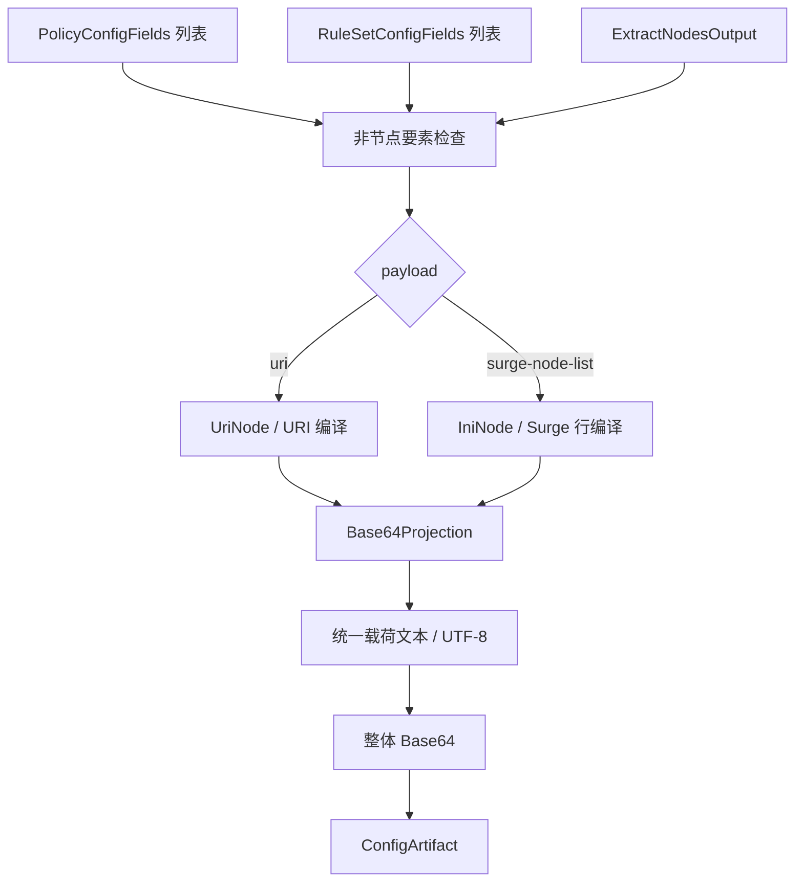

# Base64 输出

## 输入与结构

三要素为 `RuleSetConfigFields[]`、`PolicyConfigFields[]`、`ExtractNodesOutput`，见[公共契约](../README.md#输出公共契约目标)。Base64 是文本包装方式，没有通用策略和规则语义。

```ts
type Base64Input = OutputInput<
  null,
  NodeOnlyOptions & {
    payload: 'uri' | 'surge-node-list';
  }
>;
type Base64Projection =
  { kind: 'uri'; nodes: UriNode[]; lines: string[] } | { kind: 'surge-node-list'; nodes: IniNode[]; lines: string[] };
interface Base64Document {
  payload: Base64Projection;
  encoding: 'base64';
}
type Base64Artifact = ConfigArtifact<Base64Document>;
```

`UriNode/IniNode` 引用[URI](../../../lib/subconverter/types/providers/uri/index.ts)和[INI](../../../lib/subconverter/types/providers/ini/index.ts)现有类型。

## 三要素处理

节点：现有 [Base64Provider](../../../lib/subconverter/providers/base64/index.ts) 解码后读 URI 或 INI；其反向转换优先 URI，Snell 或 URI 无法输出的节点回退 Surge INI 节点。因此得到的 `Base64Node[]` 可能混合两种形态，不能直接逐对象拼接为同一种订阅。

目标输出必须先选 payload。URI 模式按[URI 输出](uri.md)编译，无法表达的节点拒绝或显式跳过；Surge 节点列表模式全部走 Surge 节点行投影并按其能力过滤，不生成组和规则。为匹配现有解码器，INI 载荷明确加 `[Proxy]` 头。不能混用 URI 行与 INI 代理行后宣称可被现有 Base64Provider 正确恢复。

策略、规则：非空时按 NodeOnlyOptions 拒绝或显式忽略，不展开成员、不获取规则资源。选择 INI payload 并不代表开启完整 Surge 配置。

## 最终处理

节点转换 → 统一载荷行类型 → 逐行序列化 → 以换行连接 → UTF-8 字节 → 标准 Base64。内部 SS/SSR/VMess 分享链接的编码已经包含在行中，外层只编码一次。`document` 保留未编码结构，`content` 是编码文本，`mediaType=text/plain`。



依据：本仓库 `lib/subconverter/providers/base64/parser.ts`、`transform.ts`。该 provider 不等于 SCE 某个固定的 mixed 目标。
