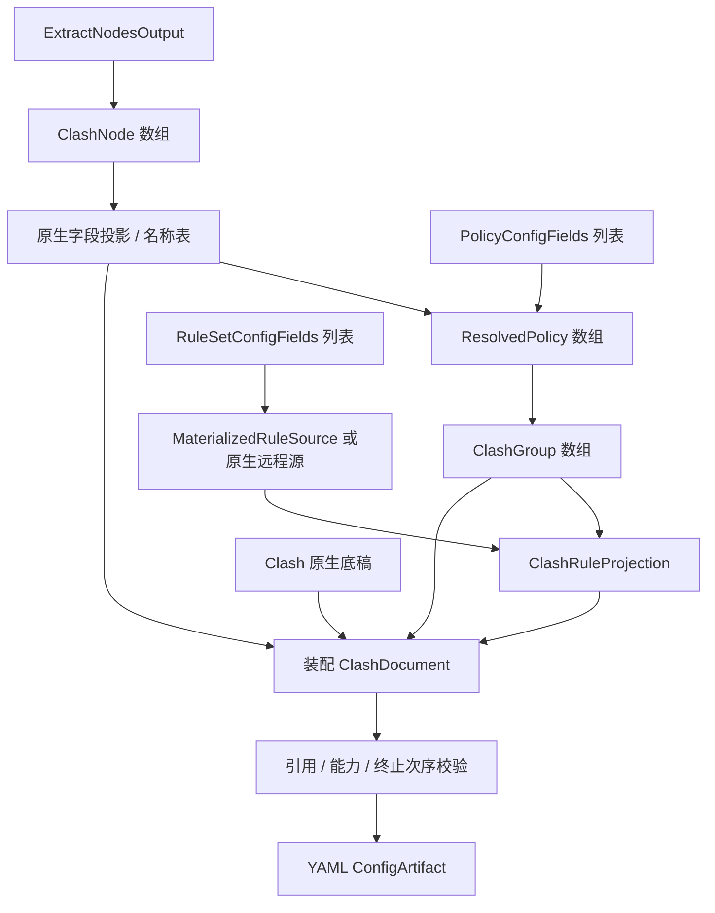

# Clash 输出

本目标通过[统一输出适配器](../output-adapter.md)以 `clash` 标识接入：三要素分别由对应 `transform` 转换，`combine` 组合为 `ClashDocument`，`toString(config)` 将该对象序列化为 YAML 文本。以下只定义本目标的转换与组装差异。

## 输入与现有边界

三要素分别为 `RuleSetConfigFields[]`、`PolicyConfigFields[]`、`ExtractNodesOutput`，定义及统一装配约束见[公共契约](../README.md#输出公共契约目标)。本目标输入：

```ts
interface ClashOptions extends OutputOptions {
  ruleMode: 'inline' | 'provider';
}
type ClashInput = OutputInput<NativeObject, ClashOptions>;
```

现有 [ClashProvider](../../../lib/subconverter/providers/clash/index.ts) 支持节点解析和双向转换；现有 `ClashConfig` 主要约束节点提取区域，不是完整输出配置类型。以下组、规则和装配结构均为目标设计。

## 节点处理

`nodes → transform('node') → ClashNode[] → 原生 YAML 节点对象`。完整节点联合引用 [ClashNode](../../../lib/subconverter/types/providers/clash/index.ts)，不另复制协议字段。转换后建立原名到输出名映射，处理重名和 `dialer-proxy` 依赖。现有节点对象使用 `skipCertVerify/dialerProxy/wsOpts` 等 camelCase；序列化需按 parser 的原生字段规则映射为 `skip-cert-verify/dialer-proxy/ws-opts` 等，不能全局按驼峰猜测所有嵌套键，headers 等用户键保持原文。

## 策略处理

`policies → ResolvedPolicy[] → ClashGroup[]`。reference 绑定内置动作、节点或组；selector 对已可输出节点求值；providers 绑定已有 `proxy-providers`。select、url-test、fallback、load-balance、relay、smart 的可用性由目标变体确认；ssid 不能直接生成 Clash 组。超出现有输入类型的策略参数不得凭空恢复。

```ts
interface ClashGroup {
  name: string;
  type: 'select' | 'url-test' | 'fallback' | 'load-balance' | 'relay' | 'smart';
  proxies?: string[];
  use?: string[];
  url?: string;
  interval?: number;
  timeout?: number;
  tolerance?: number;
}
interface ClashRuleProvider {
  type: 'http';
  behavior: 'domain' | 'ipcidr' | 'classical';
  url: string;
  path: string;
  interval: number;
  format?: 'yaml' | 'text' | 'mrs';
}
```

组内节点和 use 分开，远程资源不可当作已知节点名展开。SCE 还会把部分来源选择器转成 provider 筛选，这是它的远程资源输入能力；当前三个数组没有足够信息自动重建该过程。

## 规则处理

内联模式：`rules → MaterializedRuleSource[] → 有序规则文本 → rules`。Clash domain/ipcidr payload 先转为对应条件，classic/Surge/QuanX 先归一规则类型。把 policy 通过符号表绑定并附加在正确语法位置，保留 no-resolve；FINAL 转为 MATCH。逻辑规则必须结构化识别策略位置，不能对整行按所有逗号无条件切分。

provider 模式：可由客户端原生消费的来源转为 `ClashRuleProvider` 和 `RULE-SET,资源名,策略`；不能原样引用非原生格式的 URL。需转换的源先内联，或显式配置转换资源服务。规则 provider 名与路径必须处理冲突；同一 URL 的多策略绑定保留多条引用。`resourceFormat` 要按具体 Clash 变体校验。该模式是待实现能力，不是现有 provider 自动生成。

```ts
interface ClashRuleProjection {
  rules: string[];
  providers: Record<string, ClashRuleProvider>;
}
type ClashDocument = NativeObject & {
  proxies: NativeObject[];
  'proxy-groups': ClashGroup[];
  rules: string[];
};
type ClashArtifact = ConfigArtifact<ClashDocument>;
```

这里 `NativeObject[]` 是节点经原生字段投影后的线格式，协议字段受 `ClashNode` 和投影器约束；底稿保留的 provider 可以为非 HTTP 类型，不受生成项 `ClashRuleProvider` 限制。

## 最终装配

读取底稿 → 合并节点及组并校验名称冲突 → 按开关保留或替换规则 → 合并生成 rule-providers → 执行完整前后置规则合并 → 引用及终止规则校验 → YAML 序列化，产物 `mediaType=text/yaml`。

SCE 普通 `rulesetToClash` 在不覆盖时先保留底稿 rules，再追加生成规则，并不会普遍替底稿移走 MATCH；完整扩展规则另走 `mergeClashRules`。目标实现若发现保留的终止规则遮蔽新增规则，应报错或由明确合并选项处理，不能声称普通转换已自动修复。旧字段 `Proxy/Proxy Group/Rule` 与 script 模式是 SCE 兼容分支，目标默认采用现代字段，不能同时写两套。



依据：SCE `src/generator/config/subexport.cpp::proxyToClash`、`clash_proxy.cpp`、`ruleconvert.cpp::rulesetToClash`、`src/generator/template/templates.cpp::renderClashScript`。完整扩展规则及远程代理资源输入边界见[其余配置](../other-options.md)。
