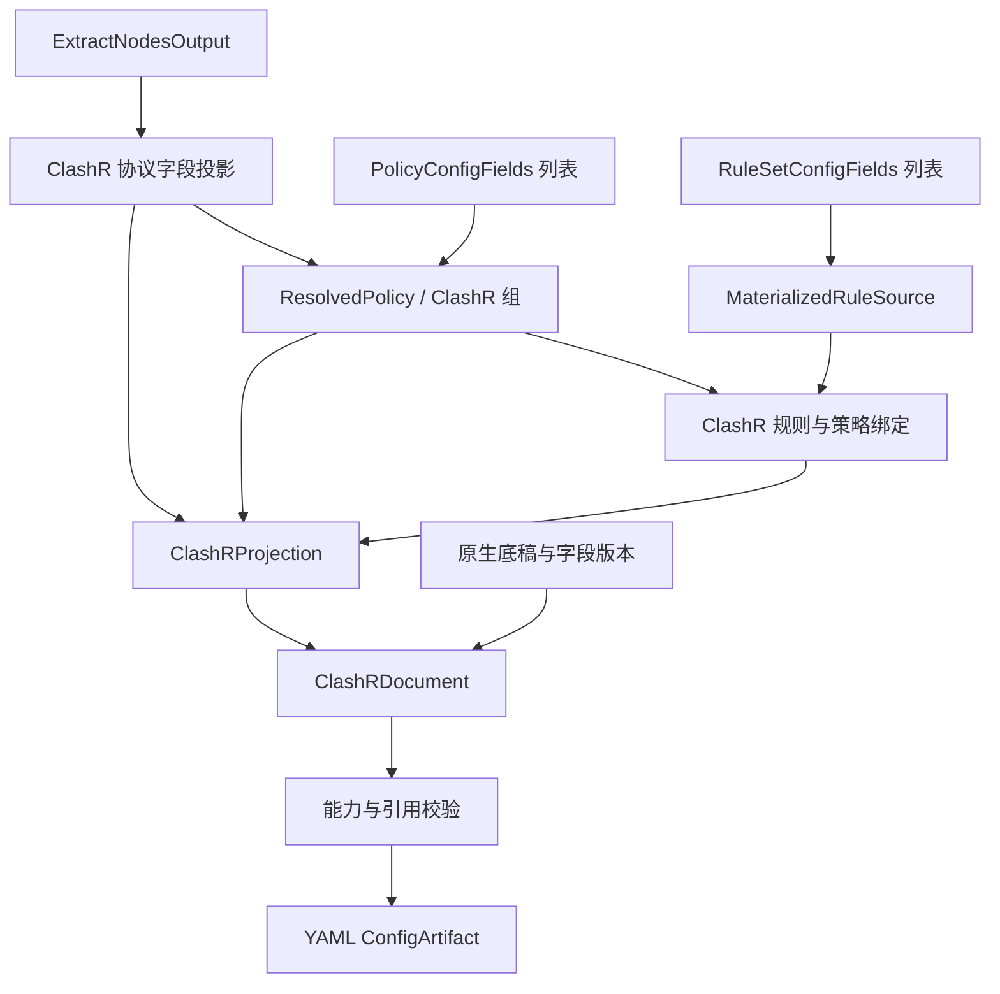

# ClashR 输出

本目标通过[统一输出适配器](../output-adapter.md)以 `clashr` 标识接入：三要素分别由对应 `transform` 转换，`combine` 组合为 `ClashRDocument`，`toString(config)` 将该对象序列化为 YAML 文本。以下只定义本目标的转换与组装差异。

三要素输入为 `RuleSetConfigFields[]`、`PolicyConfigFields[]`、`ExtractNodesOutput`，定义见[公共契约](../README.md#输出公共契约目标)。本仓库没有独立 ClashRProvider，SCE 使用 `proxyToClash(..., clashr=true, ...)`；其节点能力不能等同于现代 Clash/Mihomo。

```ts
type ClashRInput = OutputInput<
  NativeObject,
  OutputOptions & {
    legacyFieldNames: boolean;
  }
>;
interface ClashRProjection {
  nodes: NativeObject[];
  groups: NativeObject[];
  rules: string[];
  symbols: SymbolBinding[];
}
type ClashRDocument = NativeObject &
  (
    | { proxies: NativeObject[]; 'proxy-groups': NativeObject[]; rules: string[] }
    | { Proxy: NativeObject[]; 'Proxy Group': NativeObject[]; Rule: string[] }
  );
type ClashRArtifact = ConfigArtifact<ClashRDocument>;
```

节点先按 ClashR 标志对应分支投影，处理 SSR 等节点的 protocol/obfs 参数，再建立实际输出名称表；不得透传现代 Clash 独有协议字段。策略先转 `ResolvedPolicy[]` 再生成该版本支持的组对象；原生组字段约束复用 [ClashGroup](clash.md#策略处理)，但类型支持必须重新按 ClashR 能力确认。

规则先形成 `MaterializedRuleSource[]`，按 Clash 规则转换绑定策略和 no-resolve；FINAL→MATCH。规则装配与[Clash](clash.md#规则处理)相同的部分通过引用复用；provider/script 与现代规则种类不能因共享转换器就默认可用，应逐项拒绝不支持的模式。

最终在底稿装配三要素，依据 legacyFieldNames 只写一套区域名称，校验名称、引用、终止位置和字段能力，输出 YAML，`mediaType=text/yaml`。保留底稿规则时同样检查已有终止规则的遮蔽；不默认复用 Stash 的终止段重排。



SCE 依据：`src/handler/interfaces.cpp` 的 clashr 分支、`src/generator/config/subexport.cpp::proxyToClash`、`clash_proxy.cpp`、`ruleconvert.cpp::rulesetToClash`。
