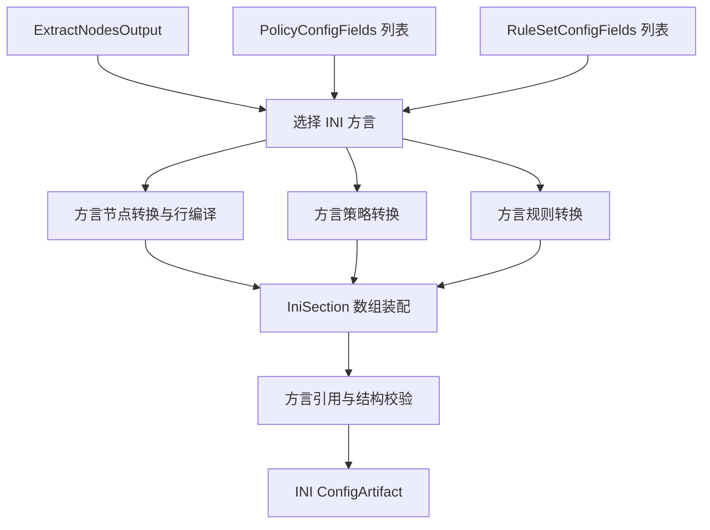

# 通用 INI 输出

三要素输入为 `RuleSetConfigFields[]`、`PolicyConfigFields[]`、`ExtractNodesOutput`，见[公共契约](../README.md#输出公共契约目标)。现有 [IniProvider](../../../lib/subconverter/providers/ini/index.ts) 用于代理行解析和转换，并未定义通用客户端的规则、组或完整配置语义；SCE 也没有名为 ini 的目标。

```ts
type IniInput = OutputInput<IniSection[], { dialect: 'surge' | 'surfboard' | 'loon' | 'quanx' }>;
interface IniProjection {
  dialect: IniInput['options']['dialect'];
  sections: IniSection[];
}
type IniArtifact = ConfigArtifact<IniProjection>;
```

`IniSection`、`IniNode`、`IniProxyNode` 引用[现有类型](../../../lib/subconverter/types/providers/ini/index.ts)。前者保存有序 lines；`IniNode` 是协议节点，`IniProxyNode` 是行表达，二者不能混用。

节点先转换成对应方言支持的协议节点，再将名称、参数、options 编译为原生行；策略和规则必须交给 dialect 对应的[Surge](surge.md)、[Surfboard](surfboard.md)、[Loon](loon.md)或[QuanX](quanx.md)适配器。不能凭 INI 能解析 section 就通用地生成 `[Proxy Group]` 和 `[Rule]`。

最终结构为该方言文档的有序 section 数组。合并保留未接管 section，按方言完成规则与组校验，再序列化 `[section]\nline...`，`mediaType=text/plain`。无明确 dialect 时完整三要素输出失败；只导出节点行应单独声明节点列表模式。


