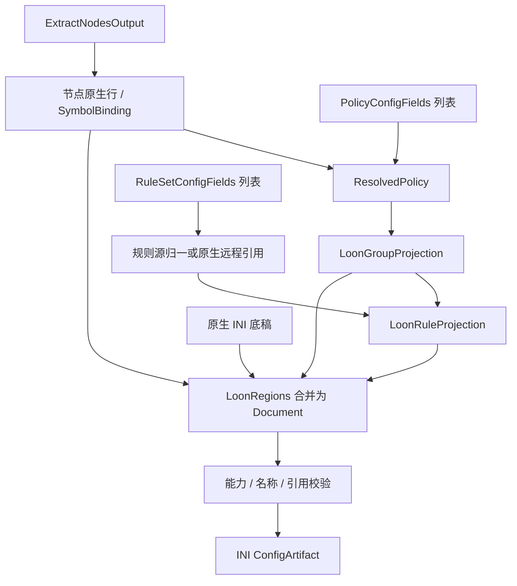

# Loon 输出

本目标通过[统一输出适配器](../output-adapter.md)以 `loon` 标识接入：三要素分别由对应 `transform` 转换，`combine` 组合为 `LoonDocument`，`toString(config)` 将该对象序列化为 INI 文本。以下只定义本目标的转换与组装差异。

## 输入

三要素为 `RuleSetConfigFields[]`、`PolicyConfigFields[]`、`ExtractNodesOutput`，类型及通用处理见[公共契约](../README.md#输出公共契约目标)。现有 [LoonProvider](../../../lib/subconverter/providers/loon/index.ts) 已实现节点转换，完整生成入口及实现边界见[订阅生成节点](../output-adapter.md#订阅生成节点)。

```ts
interface LoonOptions extends OutputOptions {
  remoteRules: boolean;
}
type LoonInput = OutputInput<IniSection[], LoonOptions>;
```

`IniSection` 引用[现有 INI 类型](../../../lib/subconverter/types/providers/ini/index.ts)，按有序行保存底稿。

## 节点处理

LoonProvider.transform('node') → LoonNode[] → Proxy 原生行。WireGuard 等需附属 section 的协议须生成相应结构，不能只写服务器行就认为字段完整。完整节点联合复用 INI 类型，但可表达字段受 Loon 转换器限制。

中间结果为 `{ lines: string[]; symbols: SymbolBinding[] }`；lines 已是目标原生行，symbols 只收录成功输出的节点。

## 策略处理

select/url-test/fallback/load-balance/ssid 分别按 Loon 语法输出，relay/smart 拒绝。测速组使用 URL/interval；algorithm 需要当前通用策略类型未包含的 strategy，不能恢复原输入未提供的意图。SCE 可保留底稿同名组的 img-url；空组补 DIRECT 属于显式兼容。

```ts
interface LoonGroupProjection {
  name: string;
  behavior: 'select' | 'url-test' | 'fallback' | 'load-balance' | 'ssid';
  members: SymbolBinding[];
  lines: string[];
}
```

流程为 `PolicyConfigFields[] → ResolvedPolicy[] → LoonGroupProjection[]`；providers 无法绑定当前目标资源时拒绝。组 lines 包括必要的目标编码，不能再交给其他方言拼装。

## 规则处理

普通规则源展开到 Rule；原生远程规则或转换服务按 Loon 分支写 Remote Rule。覆盖时同时清空 Rule 与 Remote Rule。不可表达的 noResolve 按能力错误处理。

```ts
interface LoonRuleProjection {
  local: string[];
  remote: string[];
}
```

`RuleSetConfigFields[] → MaterializedRuleSource[] 或原生远程源 → RuleProjection`。内联项不下载；远程项按源格式归一，再附加 policy 的目标名称。保留绑定与源内次序。remote 为空不代表删除底稿资源。

## 最终结构与装配

```ts
interface LoonRegions {
  nodes: { section: 'Proxy'; lines: string[] };
  groups: { section: 'Proxy Group'; lines: string[] };
  rules: { section: 'Rule'; lines: string[] };
  extraSections: IniSection[];
}
interface LoonDocument {
  sections: IniSection[];
}
type LoonArtifact = ConfigArtifact<LoonDocument>;
```

Regions 是装配前分区，Document.sections 是合并后的最终有序结构；额外 section 用于协议附属项或远程规则资源。处理 Proxy、Proxy Group、Remote Proxy、Remote Filter 名称冲突。SCE 可生成 NameRegex 远程过滤器并作为组成员；三个数组不含资源 URL，不能自动重建。保留未接管 section 并检查终止规则次序。

最终检查名称、组引用、规则策略、目标字段和分隔符，序列化为 `[section]` 与原生行，`mediaType=text/plain`。不能压成单值键字典。前后置完整 Clash 规则不自动套用本目标。



SCE 依据：`src/generator/config/subexport.cpp::proxyToLoon`、`src/generator/config/ruleconvert.cpp::rulesetToSurge（-4）`。其余选项见[配置归属](../other-options.md)。
