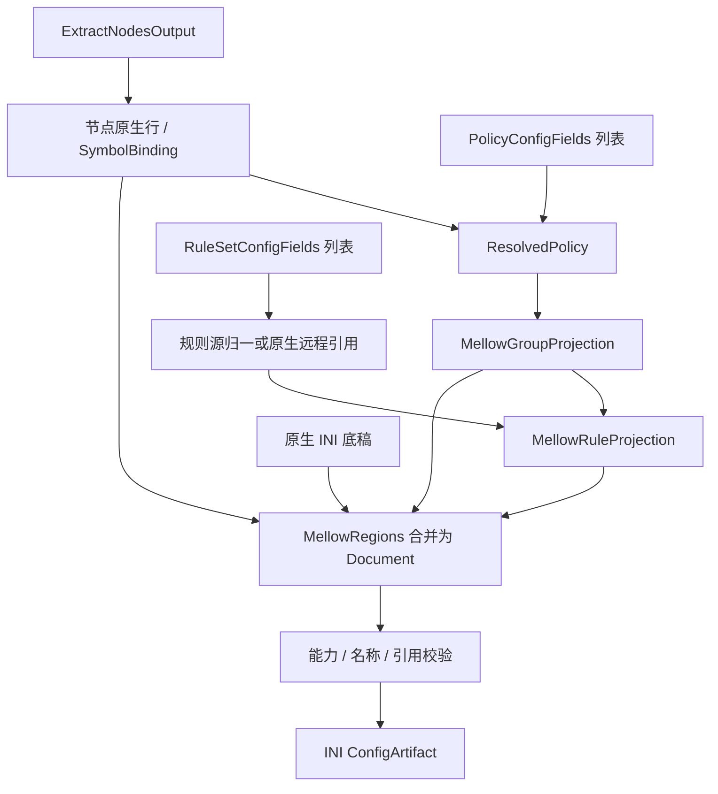

# Mellow 输出

## 输入

三要素为 `RuleSetConfigFields[]`、`PolicyConfigFields[]`、`ExtractNodesOutput`，类型及通用处理见[公共契约](../README.md#输出公共契约目标)。本仓库无独立 provider，以下是基于 SCE 的待实现目标约束。

```ts
interface MellowOptions extends OutputOptions {
  compatibility: 'strict' | 'sce';
}
type MellowInput = OutputInput<IniSection[], MellowOptions>;
```

`IniSection` 引用[现有 INI 类型](../../../lib/subconverter/types/providers/ini/index.ts)，按有序行保存底稿。

## 节点处理

本仓库无 MellowProvider；SCE 将节点编译为 Endpoint，VMess 等使用目标链接，HTTP/SOCKS 等使用 builtin endpoint；协议能力按 proxyToMellow 分支判断，不能直接输出 Surge Proxy 行。

中间结果为 `{ lines: string[]; symbols: SymbolBinding[] }`；lines 已是目标原生行，symbols 只收录成功输出的节点。

## 策略处理

SCE 接收 select/url-test/fallback/load-balance，但统一写 latency 并硬编码 interval=300、timeout=6，成员以冒号连接；groupGenerate 此分支不直接加入 [] 显式引用。空组回退全部节点或 DIRECT。严格模式拒绝无法表达的意图，兼容模式报告这些语义降级。

```ts
interface MellowGroupProjection {
  name: string;
  behavior: 'latency';
  members: SymbolBinding[];
  lines: string[];
}
```

流程为 `PolicyConfigFields[] → ResolvedPolicy[] → MellowGroupProjection[]`；providers 无法绑定当前目标资源时拒绝。组 lines 包括必要的目标编码，不能再交给其他方言拼装。

## 规则处理

服务端归一后按 rulesetToSurge 的 0 分支写 RoutingRule。条件和动作按 Mellow 能力验证，不自动生成客户端远程规则 provider。

```ts
interface MellowRuleProjection {
  local: string[];
  remote: string[];
}
```

`RuleSetConfigFields[] → MaterializedRuleSource[] 或原生远程源 → RuleProjection`。内联项不下载；远程项按源格式归一，再附加 policy 的目标名称。保留绑定与源内次序。remote 为空不代表删除底稿资源。

## 最终结构与装配

```ts
interface MellowRegions {
  nodes: { section: 'Endpoint'; lines: string[] };
  groups: { section: 'EndpointGroup'; lines: string[] };
  rules: { section: 'RoutingRule'; lines: string[] };
  extraSections: IniSection[];
}
interface MellowDocument {
  sections: IniSection[];
}
type MellowArtifact = ConfigArtifact<MellowDocument>;
```

Regions 是装配前分区，Document.sections 是合并后的最终有序结构；额外 section 用于协议附属项或远程规则资源。在底稿装配 Endpoint、EndpointGroup、RoutingRule；覆盖只影响规则区。原实现部分区域保留底稿项，目标实现应检查重复节点和组名，不能以可序列化代替结构校验。

最终检查名称、组引用、规则策略、目标字段和分隔符，序列化为 `[section]` 与原生行，`mediaType=text/plain`。不能压成单值键字典。前后置完整 Clash 规则不自动套用本目标。



SCE 依据：`src/generator/config/subexport.cpp::proxyToMellow`、`src/generator/config/ruleconvert.cpp::rulesetToSurge（0）`。其余选项见[配置归属](../other-options.md)。
