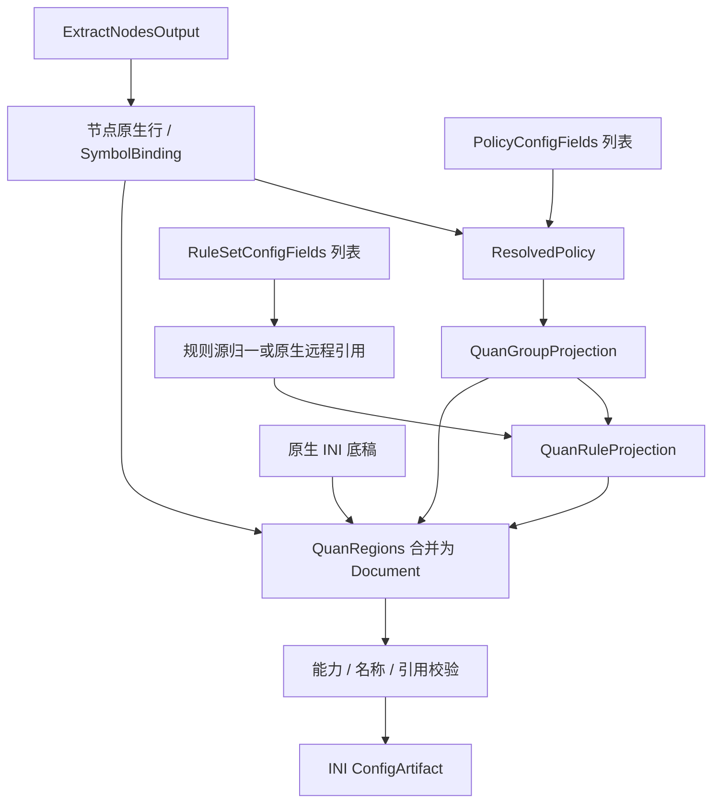

# Quantumult 输出

## 输入

三要素为 `RuleSetConfigFields[]`、`PolicyConfigFields[]`、`ExtractNodesOutput`，类型及通用处理见[公共契约](../README.md#输出公共契约目标)。本仓库无独立 provider，以下是基于 SCE 的待实现目标约束。

```ts
interface QuanOptions extends OutputOptions {
  compatibility: 'strict' | 'sce';
}
type QuanInput = OutputInput<IniSection[], QuanOptions>;
```

`IniSection` 引用[现有 INI 类型](../../../lib/subconverter/types/providers/ini/index.ts)，按有序行保存底稿。

## 节点处理

本仓库无 QuanProvider；SCE 在 SERVER 编译 Quantumult 代理行，部分 nodelist 分支输出编码链接，完整配置与节点列表分开。不能将 QuanXProvider 当作等价实现。

中间结果为 `{ lines: string[]; symbols: SymbolBinding[] }`；lines 已是目标原生行，symbols 只收录成功输出的节点。

## 策略处理

select/fallback→static，url-test→auto，load-balance→balance, round-robin；ssid 单独处理网络映射。先形成每组多行载荷，再分别 Base64 编码写 POLICY；不是对整个 INI 编码。SCE 单成员变 static、空组补 direct，严格模式拒绝有损行为。

```ts
interface QuanGroupProjection {
  name: string;
  behavior: 'static' | 'auto' | 'balance' | 'ssid';
  members: SymbolBinding[];
  lines: string[];
}
```

流程为 `PolicyConfigFields[] → ResolvedPolicy[] → QuanGroupProjection[]`；providers 无法绑定当前目标资源时拒绝。组 lines 包括必要的目标编码，不能再交给其他方言拼装。

## 规则处理

先归一规则源，再通过 -2 分支写 TCP，IP-CIDR6→IP6-CIDR，MATCH→FINAL。不是 QuanX 的 filter_local/filter_remote；按服务端内联处理，不自动创建远程引用。

```ts
interface QuanRuleProjection {
  local: string[];
  remote: string[];
}
```

`RuleSetConfigFields[] → MaterializedRuleSource[] 或原生远程源 → RuleProjection`。内联项不下载；远程项按源格式归一，再附加 policy 的目标名称。保留绑定与源内次序。remote 为空不代表删除底稿资源。

## 最终结构与装配

```ts
interface QuanRegions {
  nodes: { section: 'SERVER'; lines: string[] };
  groups: { section: 'POLICY'; lines: string[] };
  rules: { section: 'TCP'; lines: string[] };
  extraSections: IniSection[];
}
interface QuanDocument {
  sections: IniSection[];
}
type QuanArtifact = ConfigArtifact<QuanDocument>;
```

Regions 是装配前分区，Document.sections 是合并后的最终有序结构；额外 section 用于协议附属项或远程规则资源。装配 SERVER、逐组编码 POLICY、TCP 并保留其他 section。覆盖只作用 TCP；保留时检查终止规则遮蔽，不生成 QuanX server_remote。

最终检查名称、组引用、规则策略、目标字段和分隔符，序列化为 `[section]` 与原生行，`mediaType=text/plain`。不能压成单值键字典。前后置完整 Clash 规则不自动套用本目标。



SCE 依据：`src/generator/config/subexport.cpp::proxyToQuan`、`src/generator/config/ruleconvert.cpp::rulesetToSurge（-2）`。其余选项见[配置归属](../other-options.md)。
