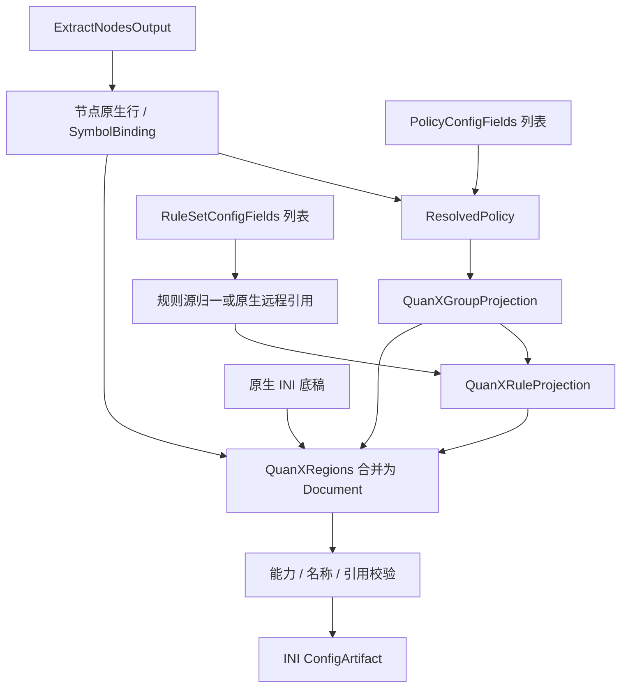

# Quantumult X 输出

本目标通过[统一输出适配器](../output-adapter.md)以 `quanx` 标识接入：三要素分别由对应 `transform` 转换，`combine` 组合为 `QuanXDocument`，`toString(config)` 将该对象序列化为 INI 文本。以下只定义本目标的转换与组装差异。

## 输入

三要素为 `RuleSetConfigFields[]`、`PolicyConfigFields[]`、`ExtractNodesOutput`，类型及通用处理见[公共契约](../README.md#输出公共契约目标)。现有 [QuanXProvider](../../../lib/subconverter/providers/quanx/index.ts) 已实现节点转换，完整配置装配尚未实现。

```ts
interface QuanXOptions extends OutputOptions {
  remoteRules: boolean;
}
type QuanXInput = OutputInput<IniSection[], QuanXOptions>;
```

`IniSection` 引用[现有 INI 类型](../../../lib/subconverter/types/providers/ini/index.ts)，按有序行保存底稿。

## 节点处理

QuanXProvider.transform('node') → QuanXNode[] → `协议 = 地址:端口, 参数, tag=名称`。allowInsecure 反向投影为 tls-verification；IPv6、tag 和参数分隔符分别处理，不能复用 Surge 行语法。

中间结果为 `{ lines: string[]; symbols: SymbolBinding[] }`；lines 已是目标原生行，symbols 只收录成功输出的节点。

## 策略处理

select→static，url-test→url-latency-benchmark，fallback→available，load-balance→round-robin，ssid→ssid；relay/smart 拒绝。组行是 `类型=组名, 成员...`，间隔写 check-interval。SCE 单成员强制 static、空组补 direct，均需显式兼容；底稿 img-url 可保留。

```ts
interface QuanXGroupProjection {
  name: string;
  behavior: 'static' | 'url-latency-benchmark' | 'available' | 'round-robin' | 'ssid';
  members: SymbolBinding[];
  lines: string[];
}
```

流程为 `PolicyConfigFields[] → ResolvedPolicy[] → QuanXGroupProjection[]`；providers 无法绑定当前目标资源时拒绝。组 lines 包括必要的目标编码，不能再交给其他方言拼装。

## 规则处理

归一条件和小写动作后写 filter_local，IP-CIDR6→IP6-CIDR。QuanX 原生规则可写 filter_remote，通过 force-policy 绑定；其他源远程引用需显式转换服务，否则内联。interval 不会自动建立资源。

```ts
interface QuanXRuleProjection {
  local: string[];
  remote: string[];
}
```

`RuleSetConfigFields[] → MaterializedRuleSource[] 或原生远程源 → RuleProjection`。内联项不下载；远程项按源格式归一，再附加 policy 的目标名称。保留绑定与源内次序。remote 为空不代表删除底稿资源。

## 最终结构与装配

```ts
interface QuanXRegions {
  nodes: { section: 'server_local'; lines: string[] };
  groups: { section: 'policy'; lines: string[] };
  rules: { section: 'filter_local'; lines: string[] };
  extraSections: IniSection[];
}
interface QuanXDocument {
  sections: IniSection[];
}
type QuanXArtifact = ConfigArtifact<QuanXDocument>;
```

Regions 是装配前分区，Document.sections 是合并后的最终有序结构；额外 section 用于协议附属项或远程规则资源。覆盖时清空 filter_local/filter_remote，否则保留后追加。server_remote 是节点资源，filter_remote 是规则资源。SCE 可通过 resource-tag-regex/server-tag-regex 选择动态远程节点；本输入无法创建远程资源，需要独立上下文或底稿。

最终检查名称、组引用、规则策略、目标字段和分隔符，序列化为 `[section]` 与原生行，`mediaType=text/plain`。不能压成单值键字典。前后置完整 Clash 规则不自动套用本目标。



SCE 依据：`src/generator/config/subexport.cpp::proxyToQuanX`、`src/generator/config/ruleconvert.cpp::rulesetToSurge（-1）`。其余选项见[配置归属](../other-options.md)。
