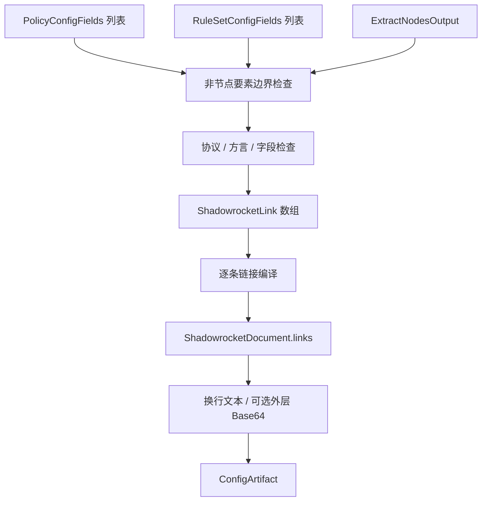

# Shadowrocket 订阅输出

## 输入

三要素分别为 `RuleSetConfigFields[]`、`PolicyConfigFields[]`、`ExtractNodesOutput`，使用[公共契约](../README.md#输出公共契约目标)。本仓库没有独立 ShadowrocketProvider；可复用通用节点字段，但不能声称现有 URI 转换已覆盖全部 SCE 方言。

```ts
type ShadowrocketInput = OutputInput<
  null,
  NodeOnlyOptions & {
    encoding: 'plain' | 'base64';
  }
>;
interface ShadowrocketLink {
  scheme: string;
  content: string;
  inputIndices: number[];
}
interface ShadowrocketDocument {
  links: string[];
}
type ShadowrocketArtifact = ConfigArtifact<ShadowrocketDocument>;
```

## 三要素处理

节点：SCE 使用独立 Shadowrocket dialect 编译分享链接，不能等同于 mixed。普通链接按目标协议语法输出；Mieru 还按来源和 profile 将多条节点聚合为一个链接，必须验证组合中的字段与传输可移植性。当前 ProxyNodeFields 没有 SCE MieruSourceId/MieruProfile 等完整来源上下文，无法无损重建这种聚合时应拒绝或要求新增资源契约，不能靠同名节点猜测。

策略：没有策略组输出区域；非空 policies 按 nonNodeElements 默认拒绝，或显式 ignore 并报告舍弃。不执行成员筛选或 provider 解析。

规则：没有规则输出区域；非空 rules 同样拒绝或显式忽略。不获取规则资源，也不生成 MATCH/FINAL 或客户端路由。

## 中间转换与最终处理

`ExtractNodesOutput → 协议及字段能力检查 → ShadowrocketLink[] → links`。中间记录保存协议载荷，链接编译器按当前方言编码；不把整个对象 JSON 化后冒充 URL。每条最终链接校验端点与转义，过滤失败节点后检查依赖。

按顺序用换行连接 links；SCE 通常在非 nodelist 模式再对整段做 Base64，nodelist 交付明文。本文显式使用 encoding，不由调用方猜测。`document.links` 始终是未做外层编码的单链接数组，`content` 是最终文本，`mediaType=text/plain`。单链接内部编码与外层编码分别执行，禁止额外二次包装。



SCE 依据：`src/handler/interfaces.cpp::kTargetDescriptors`、`src/generator/config/subexport.cpp::proxyToShadowrocket` 及其内部 SingleLinkProfile 分支。目标不读取完整配置底稿，不包含规则组和策略组。
