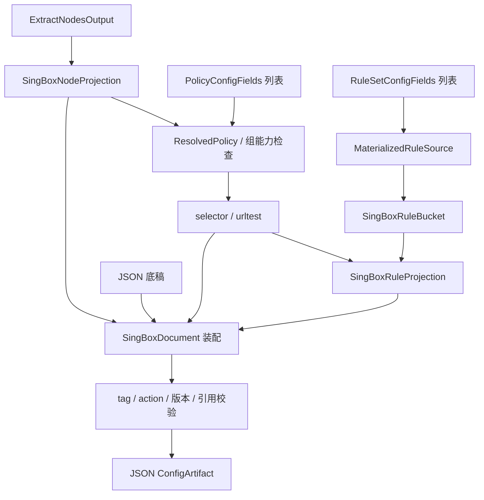

# sing-box 输出

本目标通过[统一输出适配器](../output-adapter.md)以 `singbox` 标识接入：三要素分别由对应 `transform` 转换，`combine` 组合为 `SingBoxDocument`，`toString(config)` 将该对象序列化为 JSON 文本。以下只定义本目标的转换与组装差异。

## 输入与版本

三要素为 `RuleSetConfigFields[]`、`PolicyConfigFields[]`、`ExtractNodesOutput`，引用[公共契约](../README.md#输出公共契约目标)。SCE 名称为 `singbox`。现有 [SingBoxProvider](../../../lib/subconverter/providers/sing-box/index.ts) 只提供配置节点提取和字段转换，不生成完整 route。

```ts
interface SingBoxOptions extends OutputOptions {
  wireGuardSchema: 'endpoint' | 'legacy-outbound';
  groupCompatibility: 'strict' | 'sce';
  addClashModes: boolean;
}
type SingBoxInput = OutputInput<NativeObject, SingBoxOptions>;
```

schema 与 action 形式必须绑定所选客户端版本；不能把本文对 SCE 源码的分析当作最新客户端通用规范。

## 节点与策略

`nodes → transform('node') → SingBoxNode[] → outbounds/endpoints`。现有转换将 ss/socks5/https 投影到 shadowsocks/socks/http，名称变为 tag，端口变为 server_port，TLS、transport、multiplex 独立投影。内部 camelCase 对象需还原原生 snake_case；完整节点与 WireGuard endpoint 类型见 [sing-box 类型](../../../lib/subconverter/types/providers/sing-box/index.ts)。现有 `toNode` 对 WireGuard 生成 endpoint；legacy outbound 若需要支持，应另有版本适配，不能声称该开关已存在于现有 transform。

`policies → ResolvedPolicy[] → selector/urltest outbound`。select 对应 selector，url-test 对应 urltest；interval 从秒转换为持续时间文本。SCE 把 fallback 和 load-balance 也变为 urltest，且只对原 url-test 附加部分测速参数，这是有损兼容；严格模式必须拒绝，兼容模式报告降级。relay、ssid、smart 无同等语义，不直接输出。providers 不可直接放入 outbounds，须先有明确资源解析能力。

```ts
interface SingBoxGroup {
  type: 'selector' | 'urltest';
  tag: string;
  outbounds: string[];
  url?: string;
  interval?: string;
  tolerance?: number;
}
interface SingBoxNodeProjection {
  outbounds: NativeObject[];
  endpoints: NativeObject[];
  symbols: SymbolBinding[];
}
```

SCE 为空组补 DIRECT，目标按显式 emptyGroup 处理。DIRECT 需要实际 direct outbound；REJECT 按目标版本转拒绝 action 或明确的内置 outbound，不能仅把字符串写入引用。

## 规则中间类型及映射

`rules → MaterializedRuleSource[] → 逐规则源 bucket → route.rules/rule_set/final`。SCE 在同一规则定义、同一策略内按条件字段聚合，不跨不同绑定合并；source/destination 的 GEOIP bucket 分开。此聚合可能改变同源不同条件种类的排列，不能跨策略或有顺序副作用的规则做优化。

```ts
interface SingBoxRuleBucket {
  field: string;
  kind: 'string' | 'integer' | 'boolean';
  values: (string | number | boolean)[];
  matchSource: boolean;
  outbound: string;
}
type SingBoxRouteRule = NativeObject & {
  action: string;
  outbound?: string;
};
interface SingBoxRemoteRuleSet {
  type: 'remote';
  tag: string;
  format: 'binary';
  url: string;
  http_client?: string;
  download_detour?: string;
}
interface SingBoxRuleProjection {
  rules: SingBoxRouteRule[];
  rule_set: SingBoxRemoteRuleSet[];
  final?: string;
}
```

| 通用规则                                               | 目标条件                                                   |
| ------------------------------------------------------ | ---------------------------------------------------------- |
| DOMAIN / DOMAIN-SUFFIX / DOMAIN-KEYWORD / DOMAIN-REGEX | domain / domain_suffix / domain_keyword / domain_regex     |
| IP-CIDR / IP-CIDR6 / SRC-IP-CIDR                       | ip_cidr / source_ip_cidr                                   |
| PORT / SRC-PORT / USER-ID                              | port / source_port / user_id，校验数值范围                 |
| PORT-RANGE / SRC-PORT-RANGE                            | port_range / source_port_range                             |
| PROCESS-NAME / PROCESS-PATH / PACKAGE-NAME             | process_name / process_path / package_name                 |
| IP-VERSION / INBOUND / PROTOCOL / NETWORK / USER       | ip_version / inbound / protocol / network / auth_user      |
| GEOIP,private / SRC-GEOIP,private                      | ip_is_private / source_ip_is_private                       |
| GEOSITE / 其他 GEOIP                                   | rule_set 引用；源 GEOIP 增加 rule_set_ip_cidr_match_source |
| MATCH / FINAL                                          | route.final，不生成普通条件规则                            |

SCE 对 GEOSITE/GEOIP 创建 binary 远程 rule_set，使用其 meta-rules-dat 地址约定；优先选底稿 default_http_client 或第一个 http_client，否则 download_detour=DIRECT。该地址策略属于 SCE 输出行为，目标实现应显式配置。普通远程规则定义不等于直接透传为 .srs。no-resolve 无等价字段；SCE 警告忽略，严格模式应拒绝该选项。

## 最终结构与装配

```ts
type SingBoxDocument = NativeObject & {
  outbounds: (NativeObject | SingBoxGroup)[];
  endpoints?: NativeObject[];
  route: NativeObject & {
    rules: SingBoxRouteRule[];
    rule_set?: (NativeObject | SingBoxRemoteRuleSet)[];
    final?: string;
  };
};
type SingBoxArtifact = ConfigArtifact<SingBoxDocument>;
```

先保留底稿未接管字段并装配节点、组及内置动作，再装配路由。覆盖规则时，SCE 仍保留 sniff、hijack-dns、resolve、route-options 等基础 action；不覆盖时保留底稿规则再追加。现有 rule_set 保留并对资源 tag 去重；只按 tag 去重前需检查同名不同 URL 冲突。新增 final 替换默认出站前检查其引用；多个 FINAL 以 SCE 最后一个为兼容行为，严格模式应拒绝不明确的多个兜底。可选 Clash modes 同时需要 GLOBAL 组和 Global/Direct 路由。

最终验证 outbounds/endpoints 的 tag、组引用、依赖及 rule_set 引用，按原生字段输出 JSON，`mediaType=application/json`。不能把 Clash 文档换键名后转 JSON。



依据：SCE `src/generator/config/subexport.cpp::proxyToSingBox`、`src/generator/config/ruleconvert.cpp::appendSingBoxRule/emitSingBoxRuleBuckets/rulesetToSingBox`。
