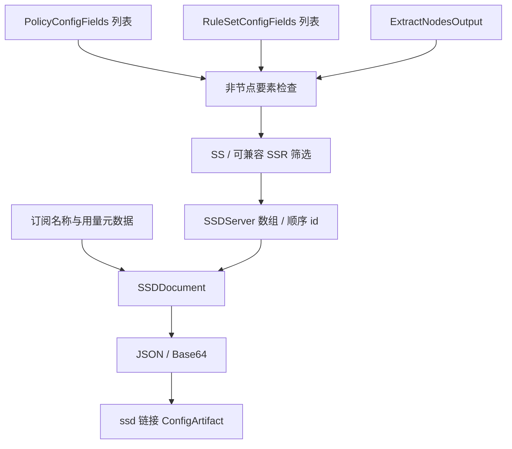

# SSD 输出

## 输入

三要素为 `RuleSetConfigFields[]`、`PolicyConfigFields[]`、`ExtractNodesOutput`，引用[公共契约](../README.md#输出公共契约目标)。本仓库无 SSDProvider。

```ts
type SSDInput = OutputInput<
  null,
  NodeOnlyOptions & {
    airport: string;
    trafficUsed?: number;
    trafficTotal?: number;
    expiry?: string;
  }
>;
interface SSDServer {
  server: string;
  port: number;
  encryption: string;
  password: string;
  plugin?: string;
  plugin_options?: string;
  remarks: string;
  id: number;
}
interface SSDDocument {
  airport: string;
  port: number;
  encryption: string;
  password: string;
  traffic_used?: number;
  traffic_total?: number;
  expiry?: string;
  servers: SSDServer[];
}
type SSDArtifact = ConfigArtifact<SSDDocument>;
```

## 三要素处理

节点筛选 SS，SCE 还允许密码算法兼容且 origin/plain 的 SSR 降为 SS；转换为 SSDServer，成功输出后按顺序分配 id。插件 obfs-local 在此方言转 simple-obfs，与 SSSub 方向不同。

策略、规则没有对应区域；非空时按 nonNodeElements 默认拒绝或显式忽略，不展开策略、不下载规则。airport 是订阅展示分组名，不是流量策略组。

## 装配与最终编码

`nodes → SSDServer[] → SSDDocument → JSON → Base64 → ssd://`。SCE 为外层设置默认连接参数，再由每个 server 覆盖其自己的 port/encryption/password；不能让客户端误用外层默认参数替代节点值。airport 缺失时使用 SCE 默认名称是兼容行为，目标可以要求显式给出。

SCE 从订阅使用量元数据提取 used/total 并转 GiB，expiry 格式化为本地时间字符串；本文 options 已是最终数值与文本，不重复换算，也不把这些值放入 ProxyNodeFields。服务端应明确 expiry 的时区。

最终 content 是 `ssd://` 加一次 JSON 的标准 Base64；不对整个 SSD 链接再次做订阅编码。document 保留 SSDDocument，`mediaType=text/plain`。



依据：SCE `src/generator/config/subexport.cpp::proxyToSSD`。
