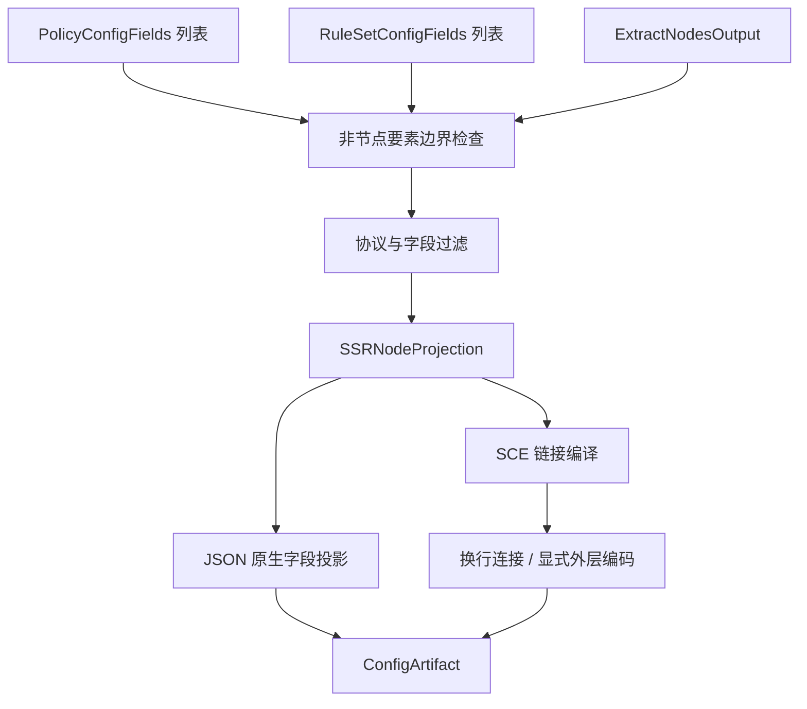

# ShadowsocksR 输出

## 输入与模式

输入三要素为 `RuleSetConfigFields[]`、`PolicyConfigFields[]`、`ExtractNodesOutput`，引用[公共契约](../README.md#输出公共契约目标)。本目标只交付节点；现有 [SSRProvider](../../../lib/subconverter/providers/ssr/index.ts) 的配置形态与 SCE 同名目标分开建模。

```ts
interface SSROptions extends NodeOnlyOptions {
  mode: 'json' | 'sce-links';
  linkEncoding: 'plain' | 'base64';
}
type SSRInput = OutputInput<null, SSROptions>;
interface SSRNodeProjection {
  nodes: SSRNode[];
  links: string[];
}
```

## 三要素处理

节点：现有 SSRProvider 转换 SSR JSON 节点，支持协议和混淆参数；内部 protocolParam/obfsParam 等字段按 SSR 原生拼写投影。现有输入既支持单配置也支持 configs；目标 JSON 模式选择 configs 包装，避免单配置必带本地监听字段的歧义。

策略：本格式没有策略组区域；非空 policies 按 nonNodeElements 拒绝或显式忽略，不展开 reference、selector、providers。

规则：本格式没有路由规则区域；非空 rules 按同一选项处理，不下载远程规则、不生成兜底动作。节点的 group/remarks 是元数据，不等于 PolicyConfigFields[]。

## 原生投影及最终结构

SCE 同名 ssr 输出 ssr://，载荷是 server:port:protocol:method:obfs:Base64(password)，查询项如 remarks、group、obfsparam、protoparam 分别编码，再对单链接载荷做 URL-safe Base64；完整订阅还可外层 Base64。它不是 SSR JSON 的序列化形式。

```ts
type SSRJsonNode = NativeObject & {
  server: string;
  server_port: number;
  method: string;
  password: string;
  protocol?: string;
  obfs?: string;
  remarks?: string;
};
type SSRDocument = { configs: SSRJsonNode[] } | { links: string[]; encoding: 'plain' | 'base64' };
type SSRArtifact = ConfigArtifact<SSRDocument>;
```

现有 `SSRNode` 的完整字段见[源码类型](../../../lib/subconverter/types/providers/ssr/index.ts)，以上 NativeObject 只用于原生字段投影后的线格式，不能绕过对应协议校验。中间节点转换后再分别进行 JSON 字段投影或链接编译；links 文档结构描述文本序列化前的载荷，不是把包装对象序列化成订阅。

JSON 模式输出 `application/json`；链接模式先以换行连接，再按 linkEncoding 决定是否整体 Base64，输出 `text/plain`。URL 编码、链接内部 Base64 与订阅外层 Base64 分开执行。过滤节点后检查依赖，不使用输入 raw 字符串绕过字段更新。



SCE 依据：`src/generator/config/subexport.cpp::proxyToSingle`；本仓库转换依据 `lib/subconverter/providers/ssr/transform.ts`。两种输出模式均为本文约定，现有 provider 未提供完整文本 exporter。
