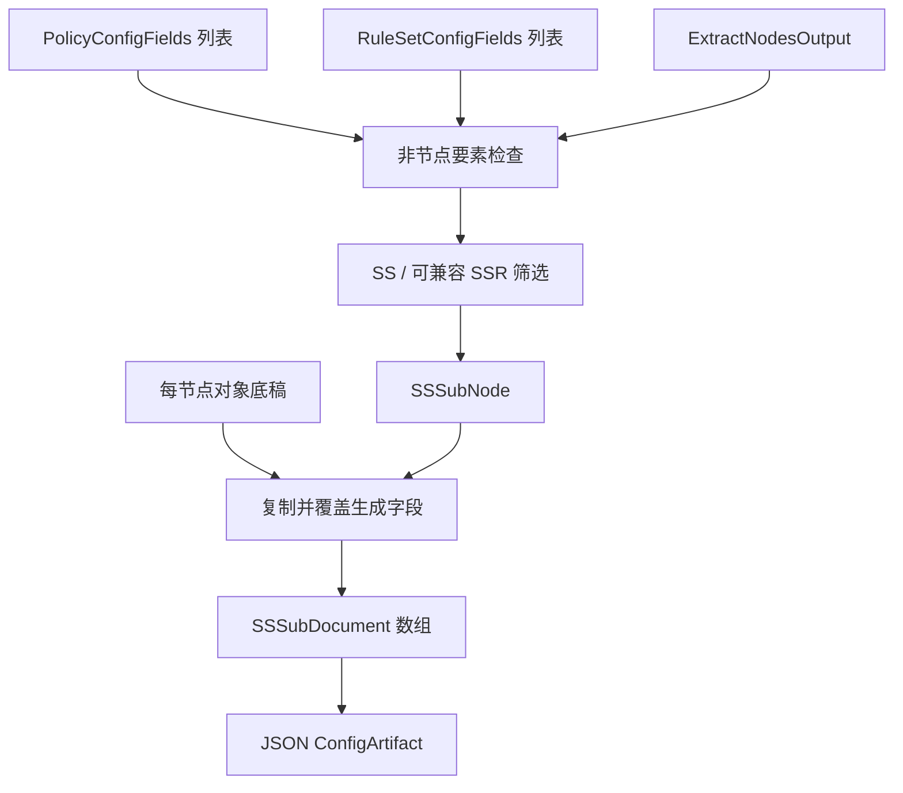

# SSSub 输出

## 输入与三要素

三要素为 `RuleSetConfigFields[]`、`PolicyConfigFields[]`、`ExtractNodesOutput`，引用[公共契约](../README.md#输出公共契约目标)。本仓库没有 SSSubProvider；现有 SSProvider 可辅助 SS 节点投影，但不等于完整兼容 SCE 行为。

```ts
type SSSubInput = OutputInput<NativeObject, NodeOnlyOptions>;
interface SSSubNode {
  remarks: string;
  server: string;
  server_port: number;
  method: string;
  password: string;
  plugin: string;
  plugin_opts: string;
}
type SSSubProjection = (NativeObject & SSSubNode)[];
type SSSubDocument = SSSubProjection;
type SSSubArtifact = ConfigArtifact<SSSubDocument>;
```

节点：筛选 SS；SCE 还接受密码算法兼容、protocol=origin 且 obfs=plain 的 SSR，将其投影为 SS 字段。simple-obfs 名称变为 obfs-local。不能对所有 SSR 都移除协议与混淆后输出。

策略：无组区域，非空 policies 默认报错或显式忽略。规则：无路由区域，同样处理；不下载规则源。

## 中间转换与装配

与完整配置底稿不同，base 是每个输出节点对象的字段底稿：对每个节点复制 base，再覆盖上面 SSSubNode 的协议字段。底稿不是整个订阅的外层包装；不得让它覆盖本次生成的 server/password 等字段。SCE 对非法或非对象底稿退回空对象；严格模式应报错以免掩盖配置错误。

`nodes → 可降为 SS 的节点集合 → 原生 SSSubNode → 每节点复制并覆盖底稿 → SSSubProjection`。最终是 JSON 节点数组，不额外包装 servers，不输出 ss://，不做订阅 Base64，`mediaType=application/json`。



依据：SCE `src/generator/config/subexport.cpp::proxyToSSSub`。
