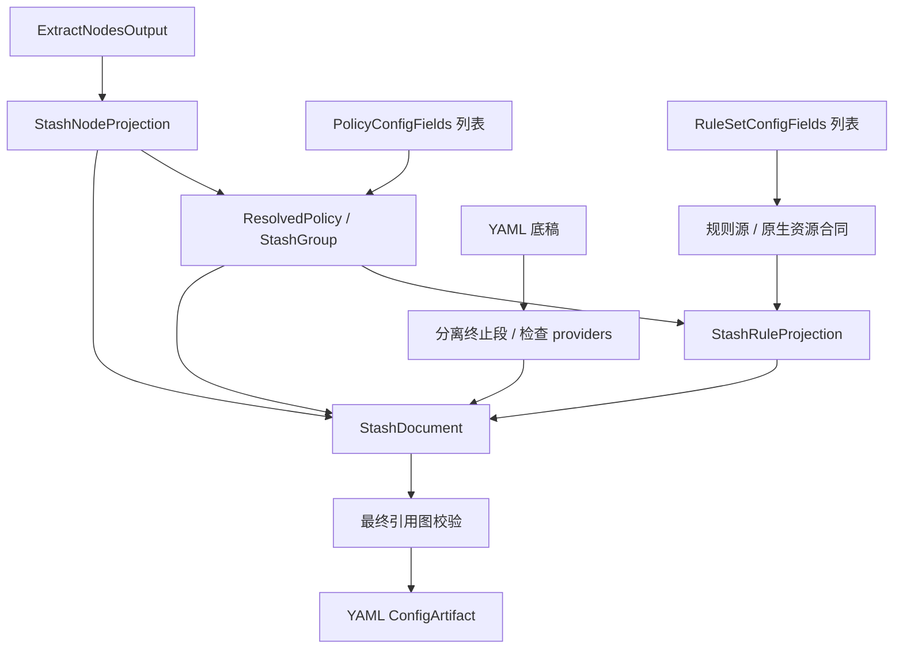

# Stash 输出

本目标通过[统一输出适配器](../output-adapter.md)以 `stash` 标识接入：三要素分别由对应 `transform` 转换，`combine` 组合为 `StashDocument`，`toString(config)` 将该对象序列化为 YAML 文本。以下只定义本目标的转换与组装差异。

## 输入与边界

三要素是 `RuleSetConfigFields[]`、`PolicyConfigFields[]`、`ExtractNodesOutput`，沿用[公共契约](../README.md#输出公共契约目标)。本仓库没有 StashProvider；不能直接用 ClashProvider 的支持列表宣称兼容。

```ts
type StashInput = OutputInput<NativeObject, OutputOptions>;
interface StashNodeProjection {
  proxies: NativeObject[];
  symbols: SymbolBinding[];
}
interface StashGroup {
  name: string;
  type: 'select' | 'url-test' | 'fallback' | 'load-balance' | 'relay';
  proxies?: string[];
  use?: string[];
  filter?: string;
  url?: string;
  interval?: number;
  tolerance?: number;
  'benchmark-url'?: string;
  'benchmark-timeout'?: number;
}
```

## 节点与策略

节点按 SCE `buildStashNode` 的协议、TLS、传输与共享字段检查生成原生代理。必须在成功输出的节点上展开策略 selector；不支持的协议或组合不能按 Clash 同名字段透传。

`policies → ResolvedPolicy[] → StashGroup[]`。smart/ssid 拒绝；relay 保持有序本地成员，不允许动态 provider 破坏链顺序。远程组的多个选择条件若无法合并为同一个 filter，应拒绝。SCE 还拒绝部分已启用的 disable-udp/persistent/evaluate-before-use 扩展；现有输入类型本身不含这些字段。load-balance strategy 不在现有通用类型，需按[附属参数边界](../other-options.md#策略扩展与远程代理资源)处理。

## 规则转换

```ts
interface StashRuleProvider {
  type: 'http';
  behavior: 'domain' | 'ipcidr' | 'classical';
  format: 'yaml' | 'text' | 'mrs';
  url: string;
  path: string;
  interval: number;
}
interface StashRuleProjection {
  prefix: string[];
  generated: string[];
  terminal: string[];
  providers: Record<string, StashRuleProvider>;
}
```

`rules → MaterializedRuleSource[] 或可原生引用的资源 → StashRuleProjection`。原生 rule-provider 合同由源格式和 resourceFormat 决定；不能把任意 Surge/QuanX 地址假装成 Stash 原生资源。支持的来源生成 provider 和 RULE-SET 引用；需要内联时规范化条件、策略与 no-resolve。无法安全表达的格式拒绝，provider 名和文件路径均检查冲突。

不覆盖底稿规则时，从首个 MATCH/FINAL 起切出 terminal 段；新增规则放在 prefix 与 terminal 之间。底稿非标量规则、非映射 rule-providers、无效资源结构必须失败；与普通 Clash 的追加逻辑不同。

## 最终装配

```ts
type StashDocument = NativeObject & {
  proxies: NativeObject[];
  'proxy-groups': StashGroup[];
  rules: string[];
  'rule-providers'?: Record<string, NativeObject | StashRuleProvider>;
};
type StashArtifact = ConfigArtifact<StashDocument>;
```

保留底稿未接管字段与已有 rule-providers；装配本地节点、组、生成规则和终止段，再校验所有节点/组/use/RULE-SET 引用。显式生成的远程代理 provider 需要额外资源输入，三个数组本身不够。最终输出 YAML，`mediaType=text/yaml`。



SCE 依据：`src/generator/config/subexport.cpp::buildStashNode/proxyToStash`、`src/generator/config/ruleconvert.cpp::rulesetToStash/inferStashNativeRulesetContract`。
