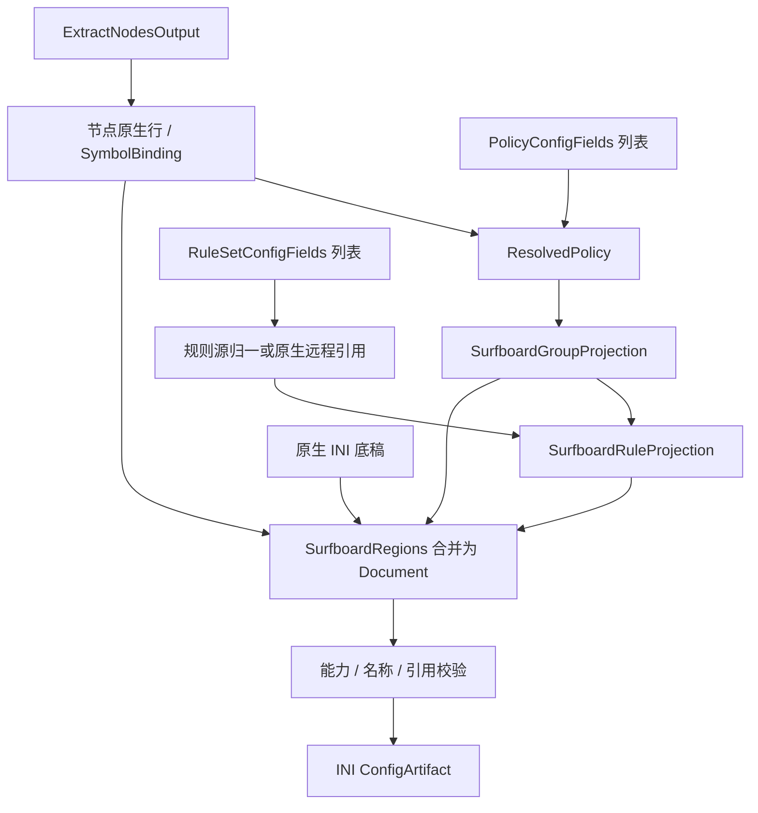

# Surfboard 输出

本目标通过[统一输出适配器](../output-adapter.md)以 `surfboard` 标识接入：三要素分别由对应 `transform` 转换，`combine` 组合为 `SurfboardDocument`，`toString(config)` 将该对象序列化为 INI 文本。以下只定义本目标的转换与组装差异。

## 输入

三要素为 `RuleSetConfigFields[]`、`PolicyConfigFields[]`、`ExtractNodesOutput`，类型及通用处理见[公共契约](../README.md#输出公共契约目标)。现有 [SurfboardProvider](../../../lib/subconverter/providers/surfboard/index.ts) 已实现节点转换，完整配置装配尚未实现。

```ts
interface SurfboardOptions extends OutputOptions {
  compatibility: 'strict' | 'sce';
}
type SurfboardInput = OutputInput<IniSection[], SurfboardOptions>;
```

`IniSection` 引用[现有 INI 类型](../../../lib/subconverter/types/providers/ini/index.ts)，按有序行保存底稿。

## 节点处理

SurfboardProvider.transform('node') → SurfboardNode[] → Proxy 原生行。虽复用 INI 协议联合，仍受 Surfboard 字段支持限制；不能把 Surge 输出直接改名。编译时处理引号、IPv6 endpoint 与 underlying-proxy。

中间结果为 `{ lines: string[]; symbols: SymbolBinding[] }`；lines 已是目标原生行，symbols 只收录成功输出的节点。

## 策略处理

共用 SCE 函数提供 select/url-test/fallback/load-balance/smart/ssid 分支，具体客户端能力仍需验证；relay 拒绝。SCE 对 url-test/fallback 的非 HTTP 测速 URL 改为 HTTP 默认地址；严格模式报错，兼容模式报告替换。tolerance 只在其支持的组上输出；load-balance 参数不能照搬 Surge。

```ts
interface SurfboardGroupProjection {
  name: string;
  behavior: 'select' | 'url-test' | 'fallback' | 'load-balance' | 'smart' | 'ssid';
  members: SymbolBinding[];
  lines: string[];
}
```

流程为 `PolicyConfigFields[] → ResolvedPolicy[] → SurfboardGroupProjection[]`；providers 无法绑定当前目标资源时拒绝。组 lines 包括必要的目标编码，不能再交给其他方言拼装。

## 规则处理

源格式归一后按 SurfRuleTypes 编译 Rule；MATCH 变 FINAL。不能输出只在正 Surge 版本成立的远程 RULE-SET 分支；noResolve 和资源格式按目标能力判断。

```ts
interface SurfboardRuleProjection {
  local: string[];
  remote: string[];
}
```

`RuleSetConfigFields[] → MaterializedRuleSource[] 或原生远程源 → RuleProjection`。内联项不下载；远程项按源格式归一，再附加 policy 的目标名称。保留绑定与源内次序。remote 为空不代表删除底稿资源。

## 最终结构与装配

```ts
interface SurfboardRegions {
  nodes: { section: 'Proxy'; lines: string[] };
  groups: { section: 'Proxy Group'; lines: string[] };
  rules: { section: 'Rule'; lines: string[] };
  extraSections: IniSection[];
}
interface SurfboardDocument {
  sections: IniSection[];
}
type SurfboardArtifact = ConfigArtifact<SurfboardDocument>;
```

Regions 是装配前分区，Document.sections 是合并后的最终有序结构；额外 section 用于协议附属项或远程规则资源。覆盖 Rule 或保留后追加，并检查 FINAL 遮蔽。policy-path 与 policy-regex-filter 采用 Surfboard 专用编码。SCE 在远程资源未被兼容组选择时失败；三个输入数组没有资源 URL，不能从 providers 名字创建 policy-path。

最终检查名称、组引用、规则策略、目标字段和分隔符，序列化为 `[section]` 与原生行，`mediaType=text/plain`。不能压成单值键字典。前后置完整 Clash 规则不自动套用本目标。



SCE 依据：`src/generator/config/subexport.cpp::proxyToSurge（surge_ver=-3）`、`src/generator/config/ruleconvert.cpp::rulesetToSurge（-3）`。其余选项见[配置归属](../other-options.md)。
