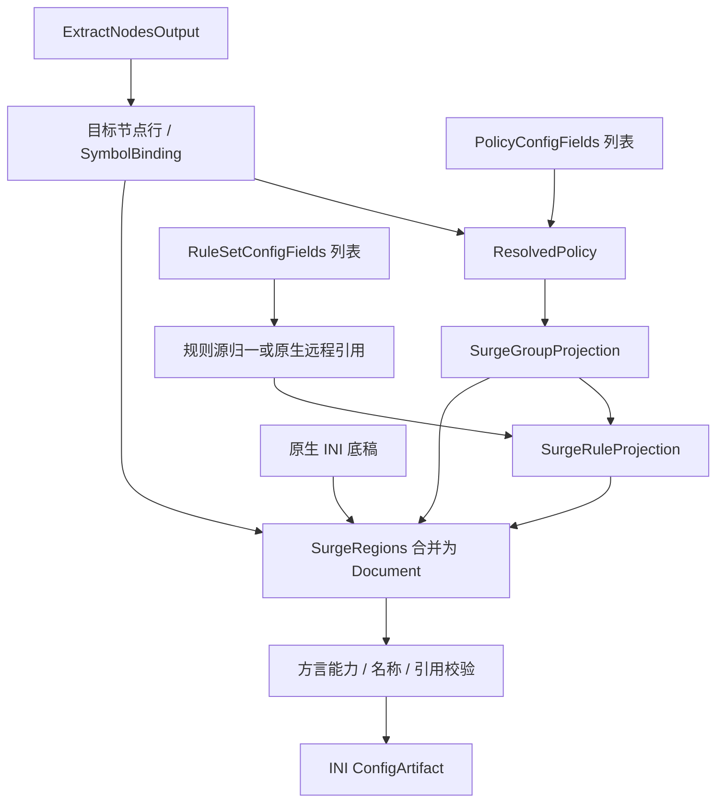

# Surge 输出

本目标通过[统一输出适配器](../output-adapter.md)以 `surge` 标识接入：三要素分别由对应 `transform` 转换，`combine` 组合为 `SurgeDocument`，`toString(config)` 将该对象序列化为 INI 文本。以下只定义本目标的转换与组装差异。

## 输入

三要素依次为 `RuleSetConfigFields[]`、`PolicyConfigFields[]`、`ExtractNodesOutput`，使用[公共类型与处理约束](../README.md#输出公共契约目标)。现有 [SurgeProvider](../../../lib/subconverter/providers/surge/index.ts) 已有节点转换；完整生成入口及实现边界见[订阅生成节点](../output-adapter.md#订阅生成节点)。

```ts
interface SurgeOptions extends OutputOptions {
  version: number;
}
type SurgeInput = OutputInput<IniSection[], SurgeOptions>;
```

`IniSection` 引用[现有类型](../../../lib/subconverter/types/providers/ini/index.ts)，以有序行保留原生底稿。

## 节点处理

使用现有 SurgeProvider.transform('node') 得到 SurgeNode[]；协议联合复用 INI 类型。编译为 `名称 = 协议,位置参数,选项`，处理引号、分隔符、IPv6 与 underlying-proxy。SCE 按 surge_ver 限制协议；本仓库 supports 不能替代版本检查。

节点投影中间结果为 `{ lines: string[]; symbols: SymbolBinding[] }`，lines 已是目标原生行，symbols 只记录实际成功输出的节点；策略不引用已被过滤的输入节点。

## 策略处理

select/url-test/fallback/load-balance/smart 按所选版本验证后输出组行；relay 无对应分支。ssid 读取默认策略与网络映射，不能把网络映射当节点正则。SCE 对单个 DIRECT/REJECT 等成员可生成 Proxy 动作别名；目标若采用该兼容行为，符号表必须记录别名所属区域。空组不自动补 DIRECT。

```ts
interface SurgeGroupProjection {
  name: string;
  behavior: 'select' | 'url-test' | 'fallback' | 'load-balance' | 'smart' | 'ssid';
  members: SymbolBinding[];
  lines: string[];
}
```

流程为 `PolicyConfigFields[] → ResolvedPolicy[] → SurgeGroupProjection[]`；lines 承载目标行语法或编码后的组载荷，不能再交给其他方言拼装。providers 若无法绑定当前目标资源则报错。

## 规则处理

先按源格式归一，再按 Surge 版本规则集合投影；MATCH 改为 FINAL。支持的远程源在版本大于 2 时可以输出 RULE-SET；非原生格式需显式转换服务前缀，不能直传 URL。update-interval 只在适用的引用上输出。逻辑规则保留嵌套语法；no-resolve 选项在 SCE 非 Clash 分支会警告忽略，目标严格模式拒绝无法表达的选项。

```ts
interface SurgeRuleProjection {
  local: string[];
  remote: string[];
}
```

流程为 `RuleSetConfigFields[] → MaterializedRuleSource[] 或可直接引用的原生源 → SurgeRuleProjection`；同一源的重复策略绑定保留，内联项不下载。remote 为空表示本次未生成远程引用，不意味着自动删除底稿资源。

## 最终结构与处理

```ts
interface SurgeRegions {
  nodes: { section: 'Proxy'; lines: string[] };
  groups: { section: 'Proxy Group'; lines: string[] };
  rules: { section: 'Rule'; lines: string[] };
  extraSections: IniSection[];
}
interface SurgeDocument {
  sections: IniSection[];
}
type SurgeArtifact = ConfigArtifact<SurgeDocument>;
```

`Regions` 是装配前分区，`Document.sections` 是合并底稿与分区后的最终结构；额外 section 用于协议附属配置或该目标远程资源。覆盖时清空 Rule，否则保留再追加；这不自动移动已有 FINAL。接管 Proxy/Proxy Group 区域时明确保留或替换同名项，拒绝冲突。policy-path 来自独立远程资源上下文，三要素只能使用已有底稿资源或本地节点。managed-config 前缀属于交付，不加入任何 section。

完成节点与组引用、规则动作、版本能力及分隔符校验后，序列化为 `[section]` 与有序原生行，`mediaType=text/plain`。重复键或多行规则不能压成单值字典。严格错误或兼容行为按 options 执行。



SCE 依据：`src/generator/config/subexport.cpp::proxyToSurge` 与 `src/generator/config/ruleconvert.cpp::rulesetToSurge（正版本）`。底稿加载、前后置完整规则和远程资源输入边界见[其余配置](../other-options.md)。
