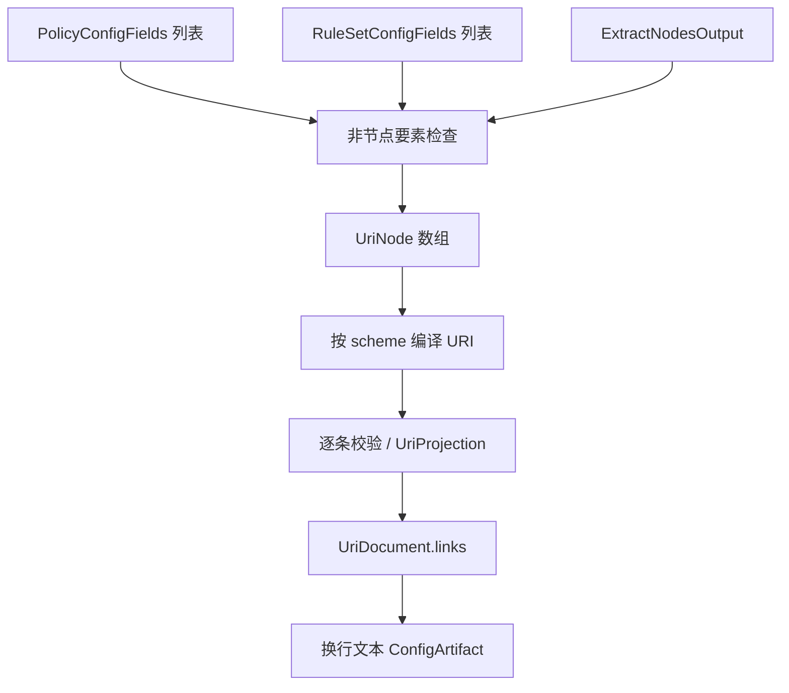

# URI 输出

## 输入

三要素为 `RuleSetConfigFields[]`、`PolicyConfigFields[]`、`ExtractNodesOutput`，沿用[公共契约](../README.md#输出公共契约目标)，本目标使用 `NodeOnlyOptions`。

```ts
type UriInput = OutputInput<null, NodeOnlyOptions>;
interface UriProjection {
  nodes: UriNode[];
  links: string[];
}
interface UriDocument {
  links: string[];
}
type UriArtifact = ConfigArtifact<UriDocument>;
```

## 节点、策略与规则

节点先调用现有 [UriProvider](../../../lib/subconverter/providers/uri/index.ts) 的 `transform('node')`，得到 [UriNode](../../../lib/subconverter/types/providers/uri/index.ts) 联合；按 scheme 再编译链接，不对对象直接 JSON 序列化。原始 raw 可选且可能缺失，不能作为唯一输出依据。

策略和规则没有对应输出区；非空时默认报错，显式 ignore 时报告舍弃，不执行 selector、不下载规则。元数据 group 不表示流量策略。

## 中间过程与序列化

`UriNode` 包括常规 URL 节点、VMess 分享配置和 SSR 配置分支。常规节点分别编码 userinfo、IPv6 host、端口、query 与 fragment；query 是有序键值对，不随意压成 Map 丢重复项。VMess 按其分享格式序列化配置并内部 Base64；SSR 先编码密码及查询值，再编码载荷。SS 按所选分享方言处理凭据与插件。

以节点输入顺序生成 `links`，每条链接独立校验后用换行连接为 `content`，`mediaType=text/plain`。该目标不加订阅外层 Base64，不因 SCE 的 mixed 支持较少协议而缩窄现有 UriProvider；具体协议可表达字段仍以转换器约束为准。



依据：本仓库 `lib/subconverter/providers/uri/transform.ts::toNode`、`parser.ts::parseUri`；SCE 分享链接参考 `src/generator/config/subexport.cpp::proxyToSingle`，不能作为本 provider 的完整协议清单。
