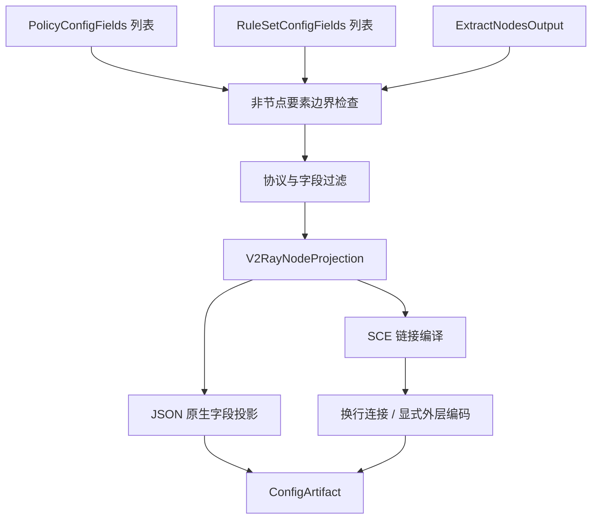

# V2Ray 输出

## 输入与模式

输入三要素为 `RuleSetConfigFields[]`、`PolicyConfigFields[]`、`ExtractNodesOutput`，引用[公共契约](../README.md#输出公共契约目标)。本目标只交付节点；现有 [V2RayProvider](../../../lib/subconverter/providers/v2ray/index.ts) 的配置形态与 SCE 同名目标分开建模。

```ts
interface V2RayOptions extends NodeOnlyOptions {
  mode: 'json' | 'sce-links';
  linkEncoding: 'plain' | 'base64';
  jsonShape?: 'core' | 'client';
}
type V2RayInput = OutputInput<null, V2RayOptions>;
interface V2RayNodeProjection {
  nodes: V2RayNode[];
  links: string[];
}
```

## 三要素处理

节点：现有 V2RayProvider supports 包括 vmess/ss/socks5。VMess 无 groupId 时投影核心 outbound，带 groupId 时投影 V2RayN 客户端记录；SS/SOCKS5 投影客户端记录。输出不能把这些记录一股脑放入 outbounds 或 vmess 数组；后者命名也不能证明每项都是 VMess。

策略：本格式没有策略组区域；非空 policies 按 nonNodeElements 拒绝或显式忽略，不展开 reference、selector、providers。

规则：本格式没有路由规则区域；非空 rules 按同一选项处理，不下载远程规则、不生成兜底动作。节点的 group/remarks 是元数据，不等于 PolicyConfigFields[]。

## 原生投影及最终结构

JSON 模式须显式选择 core 或 client。core 接受可表达的 VMess outbound；客户端记录不属于 core outbound，不能通过删掉 configType 变成核心结构。client 模式必须额外处理 VMess 的现有 groupId 分支，否则不支持的形态报错。SCE 同名 v2ray 实际是 VMess 分享链接集合，不是 V2Ray 核心完整路由配置；v2rayn/v2rayng 另有目标。

```ts
type V2RayDocument =
  { outbounds: NativeObject[] } | { vmess: NativeObject[] } | { links: string[]; encoding: 'plain' | 'base64' };
type V2RayArtifact = ConfigArtifact<V2RayDocument>;
```

现有 `V2RayNode` 的完整字段见[源码类型](../../../lib/subconverter/types/providers/v2ray/index.ts)，以上 NativeObject 只用于原生字段投影后的线格式，不能绕过对应协议校验。中间节点转换后再分别进行 JSON 字段投影或链接编译；links 文档结构描述文本序列化前的载荷，不是把包装对象序列化成订阅。

JSON 模式输出 `application/json`；链接模式先以换行连接，再按 linkEncoding 决定是否整体 Base64，输出 `text/plain`。URL 编码、链接内部 Base64 与订阅外层 Base64 分开执行。过滤节点后检查依赖，不使用输入 raw 字符串绕过字段更新。



SCE 依据：`src/generator/config/subexport.cpp::proxyToSingle`；本仓库转换依据 `lib/subconverter/providers/v2ray/transform.ts`。两种输出模式均为本文约定，现有 provider 未提供完整文本 exporter。
