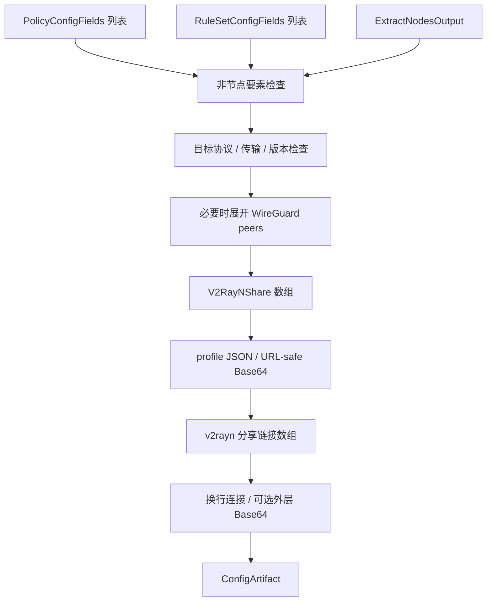

# v2rayN 输出

## 输入

三要素为 `RuleSetConfigFields[]`、`PolicyConfigFields[]`、`ExtractNodesOutput`，见[公共契约](../README.md#输出公共契约目标)。本仓库没有独立 V2RayNProvider；SCE 使用 `proxyToV2RayClient` 的对应目标分支。

```ts
type V2RayNInput = OutputInput<
  null,
  NodeOnlyOptions & {
    encoding: 'plain' | 'base64';
  }
>;
type V2RayNProfile = NativeObject & {
  ConfigType: number;
  ConfigVersion: 4;
  Remarks: string;
  Address: string;
  Port: number;
};
interface V2RayNShare {
  inputIndex: number;
  scheme: string;
  profile: V2RayNProfile;
}
interface V2RayNDocument {
  links: string[];
}
type V2RayNArtifact = ConfigArtifact<V2RayNDocument>;
```

## 三要素处理

节点先筛选该目标支持的协议和字段，再投影为版本化客户端 profile。认证字段、TLS/Reality、传输、核心选择等字段由协议分支补齐；上面的 NativeObject 部分只承接已通过该分支校验的原生字段，不是任意透传。SCE 在部分需要指定核心的协议上写 CoreType；判断依赖目标版本、协议和传输。不能直接把本仓库 V2RayNProxyNode 的 configType/address 等 camelCase 字段作为此分享载荷，它们的结构和版本并不相同。

WireGuard 多 peer 在 SCE 中展开为多个分享 profile，并给名称加 peer 序号；一条输入转换失败时回滚该输入已生成的全部分享项，不能交付半条节点。当前统一类型的 peer 数组见[节点协议类型](../../../lib/subconverter/types/proxy-node/protocols/wireguard.ts)。

策略、规则均没有目标区域；非空时按 nonNodeElements 拒绝或显式忽略。不展开组成员、不下载规则，也不把 core routing 自动塞入节点 profile。

## 中间过程与最终输出

`ExtractNodesOutput → 协议能力检查 → V2RayNShare[] → profile JSON → URL-safe Base64 → 单链接`。每条链接使用 `v2rayn://{scheme}/{encodedProfile}`，包括 Android 目标；不是普通 vmess:// 链接集合。

将 links 按顺序换行连接，encoding=base64 时再对整段做标准 Base64；plain 对应 SCE 的 nodelist 文本。document 保存单链接数组，content 保存最终文本，`mediaType=text/plain`。目标载荷版本与字段分支必须固定，不能直接宣称支持所有客户端版本。



SCE 依据：`src/generator/config/subexport.cpp::writeV2RayProfilePayload/proxyToV2RayClient`。协议数值枚举与全部字段不在文档重复维护，应以对应分支为准。
